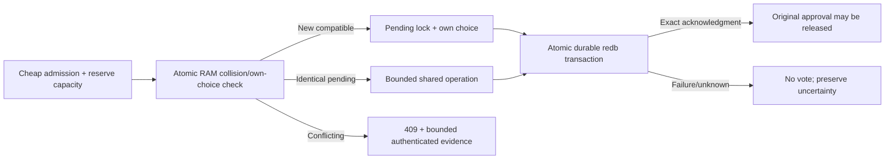

# 02. Lock State, Conflict Evidence and Regional Merge

> Canonical selected requirements. [Spec03](03_routing_und_sharding.md) defines
> committees/readiness, [Spec14](14_node_persistenz_und_redb_speicher.md) durability.
> Selection is distinct from completed proof and implemented behavior.

## 1. Three independent kinds of state

The local write path atomically excludes incompatible consumption of one specific
`parent_lock`/output. It reserves bounded persistence capacity before RAM mutation,
records a pending decision, and waits without RAM guards for the bounded worker's
atomic durable lock+immutable-own-choice commit. Only then may an original approval
escape or count as self vote. An identical pending request joins the same bounded
operation; enqueue/RAM acceptance alone is not success.

The immutable own decision is distinct from the derived current canonical lock
state and from the client-visible maturity indicator. A lawful merge may revise
current canonical state, while original own choices are never rewritten into
contradictory approvals. A live-state signature reports the new safely installed
state under its separate purpose/challenge; it does not falsely reissue a write vote.

## 2. Binary assurance and conflict result

| Result | Required evidence | Meaning/limit |
| --- | --- | --- |
| PROVISIONAL | At N<20, verified adaptive Q(N)=floor(2N/3)+1 | Regional sub-quorum acceptance; recipient policy must expose the risk. |
| FINAL | At N>=20 with existing stability rule, fourteen distinct valid votes from one justified frozen top20 | Regional/revisable acceptance under DEC-053/054; no unconditional global irreversibility. |
| Conflict/VOID | Justified canonical competitor under the class-aware resolver | Losing branch cannot authorize spending under that evidence. Losing alone does not prove server fraud. |
| Unknown/uncertain | Missing proof, insufficient quorum or unsafe readiness | No payment release; matching individual records are diagnostic only. |

There is no third assurance tier. A10:10 distribution does not yield fourteen
votes; the collector must not call either branch paid. Use409 when an actual
validated conflict is established; insufficient quorum alone remains an uncertain
503-style outcome. A weaker competing observation cannot veto an otherwise valid
fourteen-vote checkout (DEC-067).

## 3. Class-aware canonical merge (DEC-064/065)

Admit only justified support. Compare class2 > class1 > class0 first, then choose
`min(H_canon)` within the highest admissible confirmed class. Unconfirmed smaller
hashes do not displace confirmed locks. `H_canon` binds canonical network/purpose
and the exact consumed-output/lock fields; all hash domains are length-prefixed.
Convergence is conditional on receiving the same admissible evidence and applying
the same rule. Arrival order alone must not change that result.

Retain the minimum sufficient live exclusion/evidence and immutable own choices
through authenticated rootTTL+30s. Clients retain full L1 causality and any excess
losing branches. This is not a historical quorum archive requirement. Exact support
proofs, descendant invalidation and activation composition remain gate S5. The old
unqualified “VOID can never change under any later evidence” wording is retired:
expiry and cryptographically invalid data remain unusable; a derived classification
must account for newly valid higher-class support rather than hiding it.

## 4. First-party fraud, not lawful losing signers

Node equivocation requires two genuine incompatible **original** decisions of the
same full identity for the same network/consumed-output slot and signing purpose.
Verify both signatures and all context before any ban. Reject forged reporters,
changed networks/purposes or mere different live observations. An honest signer
on a regionally valid losing branch is not punished simply for the merge loss.

Verified node fraud triggers NodePubKey revocation, ticket invalidation and WoT
severance under the first-party doctrine. L1 owner fraud and its L1 disposition
are separate domain integration; L2 does not invent monetary compensation, staking,
civil liability or a guaranteed de-anonymization implementation.

Locks travel by shard-direct RPC and verified active sync. Only hourly presence
and verified first-party fraud use the two F2F gossip streams.

## 5. Collision evidence, retries and promotion

Return bounded compact authenticated competing-lock evidence inline with409
(DEC-066), binding the target/slot/context. A gateway reference cache, historical
quorum bundle and extra mandatory evidence-fetch round are unnecessary. Reporting
a valid conflict is neutral, not peer misbehavior. Observing a competitor alone
is not automatically a proof of two incompatible signatures of the same node.

Identical committed retries preserve the original decision; cancelled/deadline
requests never roll back successful commits. The client reconciles uncertainty
using bounded exact-payload retries and fresh proof, without substitute spending.
A valid-prefix ancestry batch stops at its first invalid/conflicting step and
keeps preceding commits (DEC-013/014).

Promotion from PROVISIONAL to FINAL requires current verified qualification and
quorum, identical lock content, no TTL extension and the existing stability gate.
The selected free identical-content upgrade does not authorize automatic paid
classification merely because the observed network grew. Exact promotion endpoint
and DTO remain shared-interface delivery work. Regional revision rules still apply.

## 6. Invariants

1. **[INV-0201] Atomic Original Choice:** First-seen exclusion applies to an exact consumed slot; incompatible original own approvals cannot replace a retained choice. Canonical merge is separate.
2. **[INV-0202] No Unsupported Resurrection:** A losing/invalid/expired branch cannot authorize payment without newly justified admissible evidence; expiry never revives. Derived class changes follow §3, not the retired unconditional VOID claim.
3. **[INV-0203] Verified Incompatible Self-Proof:** Slashing requires both genuine incompatible same-identity/slot/purpose original signatures; lawful merge losses and live reports alone are insufficient.
4. **[INV-0204] Physical Root Expiry:** Purge root-bound locks and own choices after root.valid_until+30s; the grace period does not extend spending validity.
5. **[INV-0205] Neutral Evidence-Backed Conflict:** An authenticated conflict refusal is not server misbehavior. A weaker observation does not veto valid quorum evidence.
6. **[INV-0206] Exact Idempotent Promotion:** Same content/root lifetime, required current quorum and stability gate; no extra charge for the identical-content upgrade and no guaranteed irreversible maturity.
