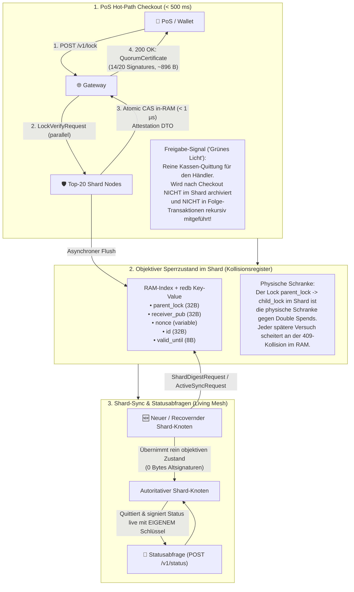

# 03. Statusabgleich & Shard-Sync (Spec 03)

> **Status:** Canonical Architecture Specification  
> **Topic:** Shard-Digest Pull, Status Queries, and Objective Lock State  
> **Related Documents:** [`03_routing_und_sharding.md`](03_routing_und_sharding.md), [`00_architektur_und_mental_model.md`](00_architektur_und_mental_model.md), [`06_dumb_server_smart_client_flow.md`](06_dumb_server_smart_client_flow.md)

---

## Objektiver Zustand statt Signatur-Archivierung (KISS-Prinzip)

Im HuMoCo Layer-2-Netzwerk gilt die strikte architektonische Trennung zwischen dem **flüchtigen Freigabe-Signal am Checkout** und dem **dauerhaften, schlanken Zustand im Shard-Register**.

### 1. Das einmalige Freigabe-Signal am Checkout (Kassenpfad)
* **Zweck:** Das Quorum-Zertifikat (14 von 20 Ed25519-Signaturen, $\approx 896\,\text{Bytes}$) dient ausschließlich als flüchtiges Freigabesignal ("grünes Licht") an der Ladenkasse.
* **Händler-Sicherheit:** Es beweist dem Händler im Augenblick des Bezahlvorgangs, dass ein BFT-Quorum zuständiger Shard-Knoten die Unbedenklichkeit bestätigt und die Ausgabe auf `parent_lock` atomar registriert hat.
* **Kein rekursives Chaining & kein Mitschleppen:** Nach erfolgtem Checkout hat dieses historische Zertifikat für spätere Empfänger keinen Erkenntniswert mehr: Ein altes Quorum-Zertifikat beweist nicht, ob ein Gutschein *jetzt* noch unverbraucht ist (da in der Zwischenzeit ein Folgetransfer stattgefunden haben könnte). Folge-Transaktionen auf Layer 1 binden daher niemals historische L2-Quorum-Zertifikate rekursiv ein.

### 2. Der dauerhafte, schlanke Zustand im Shard (Kollisionsregister)
* **Physische Schranke:** Im Shard verbleibt lediglich der reine, objektive Datensatz: `parent_lock -> id` (zusammen mit `receiver_pub`, `nonce` und `valid_until`).
* **Unabhängigkeit von Altsignaturen:** Sobald ein Lock synchronisiert ist, scheitert jeder Double-Spend-Versuch deterministisch an der Kollisionsprüfung im RAM-Index ($< 1\,\mu\text{s}$) bzw. im persistenten `redb`-Speicher (`409 Conflict`) — völlig unabhängig davon, welche spezifischen Knoten ihn vor Monaten signiert haben oder ob diese Knoten überhaupt noch existieren.
* **Verfallszeit (TTL):** Der Zustand existiert exakt bis zum Ablauf der Gutschein-Wurzel (`root.valid_until` + 30s Grace-Period) und wird danach physisch aus RAM und Platte getilgt (*Zero State Bloat*).

### 3. Shard-Sync ohne Signatur-Müll (Anti-Bloat & KISS)
* **Reine Zustandssynchronisation:** Die deterministische Digest-Berechnung:
  $$\text{ShardDigest}(S) = \text{BLAKE3}\Big(0\text{x01} \mathbin{\Vert} \text{Shard\_ID} \mathbin{\Vert} \text{Lock}_1 \mathbin{\Vert} \dots \mathbin{\Vert} \text{Lock}_m\Big)$$
  hasht und vergleicht ausschließlich die Felder `parent_lock`, `receiver_pub`, `nonce` und `id` der aktiven Locks.
* **Ausschluss von Node-Attestierungen:** Historische Node-Signaturen oder 896-Byte-Quorum-Bündel sind im Digest **explizit nicht enthalten**. Würden Signaturen synchronisiert, würde das Datenvolumen pro Lock um ein Vielfaches explodieren, ohne jeglichen Sicherheitsgewinn für die Kollisionserkennung zu bieten.
* **Netzwerk-Schlankheit:** Über den Wire-Endpunkt `/v1/sync` bzw. QUIC `ActiveSyncRequest` werden reine `LockRecordDto`-Instanzen ausgetauscht.

### 4. Living Mesh statt Geisterknoten-Archivierung
* **Lebendige Autorität:** Neu hinzutretende oder nach einem Neustart synchronisierte Shard-Knoten übernehmen den objektiven Sperrzustand und werden sofort vollwertig handlungsfähig.
* **Eigene Quittierung:** Eingehende Statusabfragen (`POST /v1/status` oder QUIC `StatusQuery`) beantwortet und signiert der *aktuell* zuständige Shard-Knoten aus seinem synchronisierten Live-Zustand heraus mit seinem **eigenen, aktiven Ed25519-Schlüssel**.
* **Keine Totengräber-Bürokratie:** Das System vermeidet so die Abhängigkeit von veralteten Signaturen längst ausgeschiedener oder rotierter Vorgängerknoten ("Geisterknoten") und garantiert liveness-deadlock-freie Shard-Kontinuität.
