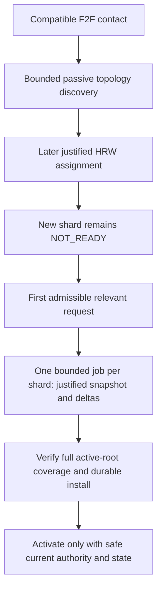

# 08. Topology Dynamics and Network Merge

> **Status:** Normative requirements reconciled with DEC-053/055/064/083–089. Regional convergence policy is distinct from a proved safe dynamic-consensus transition. Evidence gaps are tracked in the [registry](INVARIANT_REGISTRY.md).

## 1. Binary network regime

For 65,536 shards, `R = min(20, N_active)` bounds replication. Below twenty locally active nodes, all participating nodes cover all shards and use adaptive `Q(N) = floor(2N/3) + 1` PROVISIONAL confirmation.

| Active network | Mode | Required evidence |
| --- | --- | --- |
| `N = 1` | PROVISIONAL | 1/1 qualified vote |
| `N = 3` | PROVISIONAL | 3/3 qualified votes |
| `N = 10` | PROVISIONAL | 7/10 qualified votes |
| `N = 19` | PROVISIONAL | 13/19 qualified votes |
| `N >= 20`, existing 24-hour stability condition satisfied | FINAL / Regional14 | Fourteen distinct verified votes from one justified frozen twenty-member snapshot |

The status names/tags remain PROVISIONAL (`0x00`) and FINAL (`0x01`) where used by the specified wire format. The former HIGH_ASSURANCE (`0x02`, sixteen signatures, `N >= 100`) tier is retired. A timeout or partial FINAL response cannot downgrade an existing twenty-member request to an adaptive minority quorum. Mode classification is bound into the authenticated purpose/context, not inferred from a count or a green UI badge.

FINAL means regional confirmation under the current authority and safety assumptions. DEC-053 permits later deterministic revision after partition healing; there is no claim of global economic irreversibility. No assumed random attacker fraction proves a per-committee Byzantine bound.

## 2. Distinct time and membership mechanisms

The existing 24-hour network-stability hysteresis for FINAL is separate from:

- The 24-hour observation/maturation wall for each new Argon2d routing ticket.
- Calendar `epoch_day` used for wire framing and ingress accounting.
- Passive hourly presence, with three consecutive missed heartbeats excluding candidates from later snapshots.
- On-demand HRW calculation and the 800 ms frozen checkout collection.

No daily committee tenure, predecessor baton certificate or active background liveness probes are introduced. Current requests do not borrow later HRW ranks. Ordinary read routing stays INV-0310 / default `read_quorum=1`.

## 3. Network domain isolation and the legacy activation manifest

Network-domain separation remains required in TLS/session admission and signed payloads: reject replay across incompatible configured domains. Heartbeat isolation is [INV-1106](11_organische_praesenz_und_dunbar_gossip.md). A mainnet/base island domain allows compatible communities to communicate under the admission rules; testnet is separate.

The older Federation Activation Manifest / `GenesisManifest` describes a founding roster, signatures and a network fingerprint. Such a fingerprint may label an existing network domain, but fourteen founder signatures do not by themselves authenticate today's entire living roster, establish ongoing authority, or prove safe state transfer. A configured-domain mismatch must not be silently bypassed in the name of automatic merge. Conversely, the historical manifest narrative must not be used to claim every independently grown regional partition is permanently incompatible or cannot face a same-domain conflict.

The precise authenticated basis for roster/domain adoption and compatible-network activation remains unresolved. Do not replace it with arbitrary gateway rosters, statistical cutoffs, matching empty digests or mandatory permission from an unavailable predecessor committee. Existing code/test names concerning manifest adoption are observations to evaluate, not proof of those properties.

## 4. Topology discovery and on-demand active-state recovery

Compatible communities first learn identities through bounded F2F heartbeat forwarding. Topology knowledge is local and may differ; equal node counts do not prove identical members. No fixed 200/500 ms discovery/merge guarantee follows from gossip fan-out.

Locks are never gossiped. A topology meeting does not trigger an unsolicited global database/history dump. Required collision state is nevertheless replicated through authorized shard-direct digest-first PULL; “no history dump” must never be read as “no active-lock synchronization.” L1 ownership history stays with clients.

Synchronization must include still-relevant locks older than 24 hours, anchored to root validity, not just a recent event window. A snapshot requires bounded catch-up for concurrent writes and a coherent install boundary. Every imported record, context and claimed support is checked before activation. Matching digests only establish agreement about supplied bytes; fourteen unready sources with empty state do not prove no prior lock existed.

Other ready shards continue normally. An unready source may serve retained data to authorized peers without being counted as a safe state witness. No payment queue is created; clients retry the exact original intent. Source continuity, omission detection, changing assignments and safe activation remain proof and implementation obligations. Successful old signers leaving alone does not turn safely transferred locks into unconfirmed state; no historical bundle archive is required.

A provisional lock is not upgraded by a timer or status-bit change. A valid current quorum after safe synchronization can attest the state at the requested stronger class; the required evidence must actually be checked. The network-size hysteresis alone is insufficient.

## 5. Deterministic conflict handling

Resolve only admissible authenticated state/support. DEC-064 selects:

1. Valid class2 FINAL/Regional14 outranks valid class1 adaptive PROVISIONAL.
2. Class0 partial votes or unconfirmed intents cannot displace a confirmed branch or establish a confirmed winner.
3. Within the highest admissible confirmed class, choose `min(H_canon)`.
4. Apply the causal VOID result to the losing branch, preserving required own-choice safety information through root TTL plus grace.

For example, a confirmed small-village lock does not override a valid class2 conflict merely because its hash is smaller. Conversely, one peer's unsupported low hash cannot replace a confirmed branch. A peer can transport many valid signatures; transport-source count is different from authenticated support.

A partition can be attacked from both sides through colluding agents or distinct connectivity. No “physical impossibility of dual ingress” is assumed. Two honest disjoint committees can each sign one branch; their later conflict is not proof that either node equivocated. Ban only an actual offender proven by two genuine incompatible signatures of that same NodePubKey in the same protected original slot. L1 fraud and owner evidence are distinct from a node-ban predicate. No honest loser is automatically slashed.

Current canonical state may become B even where a node's immutable original decision was A. A purpose-separated current-state response can honestly report B; it never overwrites or licenses a contradictory original approval. Deterministic eventual convergence does not reverse goods already handed over and is not a proof of safe activation under every dynamic view.

## 6. Existing topology invariants and revised semantics

1. **[INV-0801] Bounded shard size:** `R = min(20, N_active)`; all sub-twenty participants cover all shards, subject to readiness.
2. **[INV-0802] Binary status eligibility:** FINAL requires the existing stable `N >= 20` condition plus actual fourteen-of-twenty valid current context-bound evidence. It is regional/revisable; the third tier/global-irreversibility promise is retired.
3. **[INV-0803] Controlled replication:** No unsolicited history dump or lock gossip. Required active state moves through authenticated bounded shard-direct PULL, with safe complete durable activation.
4. **[INV-0804] Admissible class-first resolution:** Apply class2 over class1; class0 cannot establish a confirmed winner. Use min-hash within the highest admissible confirmed class. This replaces unconditional hash-only takeover and automatic honest-loser slashing.
5. **[INV-0805] Verified quorum, not bitmap self-proof:** Status plus `count_ones >= 14` is insufficient. Verify every full identity/signature, justified frozen committee and exact purpose/target/state/challenge context. The former bitmask-only definition is explicitly withdrawn.
6. **[INV-0806] Domain compatibility:** Existing incompatible authenticated network domains remain isolated; a founder manifest is not ongoing membership authority or a proof excluding same-domain regional conflicts. The historical absolute non-merge claim is qualified by this distinction; domain-adoption authority remains open.

## 7. Evidence gates

Adversarial real QUIC checks must cover conflicting same-domain regional state, wrong-domain messages, missing active locks older than 24 hours, empty unready digests, delta races and a changed assignment at install. Client tests must reject partial/mixed-class/wrong-context evidence and bitmap-only FINAL. Durable-before-release requires crash evidence. Those tests plus an explicit source/authority/activation argument are required; no execution or completeness claim is made here.
