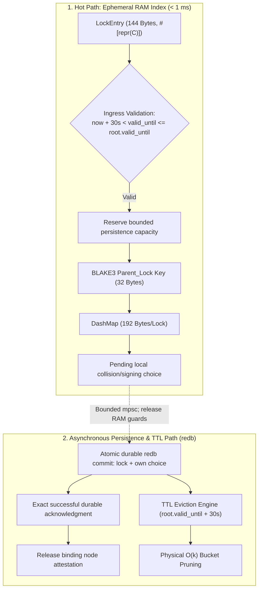
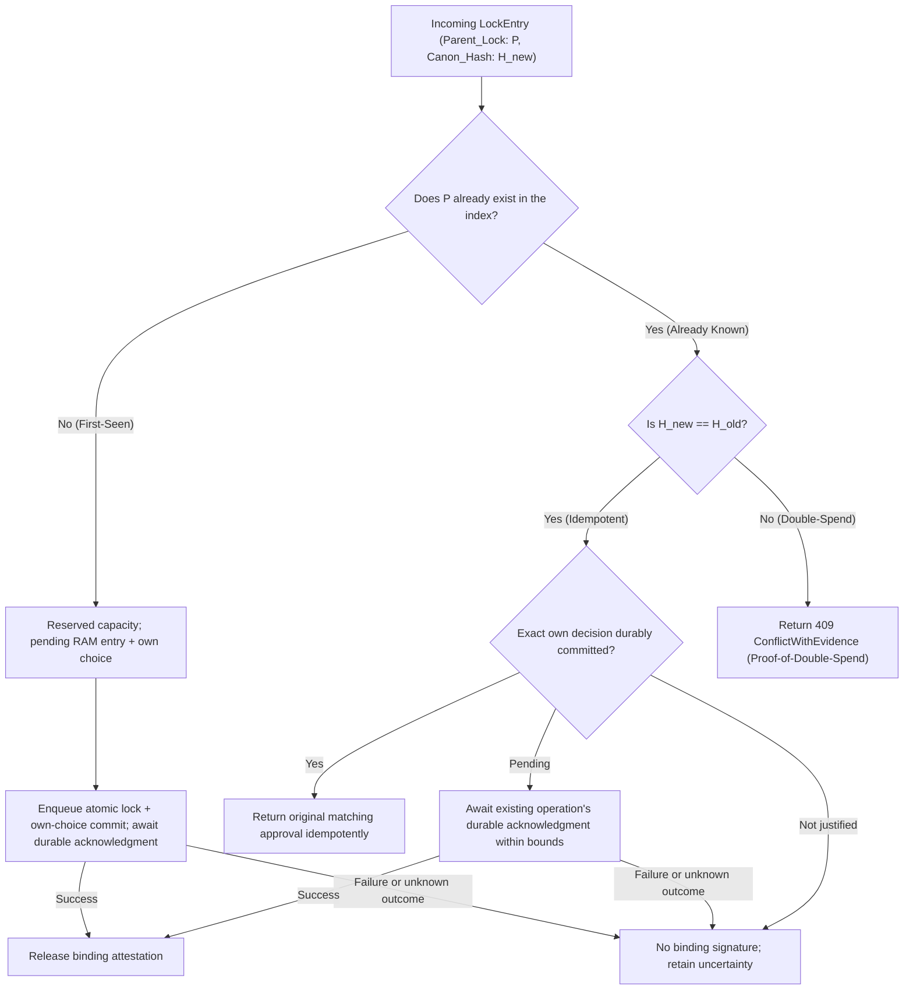

# 12. Lock Storage & RAM Index Architecture

> **Status:** Standard  
> **Model:** Logic & State Graph First  

This document specifies the **High-Performance Hybrid Storage Engine** of a Layer-2 shard node. It defines the **concurrent atomic collision index as PoS Fast-Path ($< 1\,\mu\text{s}$)**, the **asynchronous persistence layer (redb)** for multi-year vouchers (1–10 years), and the **deterministic eviction after expiry of the Voucher Root (`root.valid_until`)** via time-based bucket indexes ($O(k)$ over expiring buckets).

---

## 1. The Hybrid Storage Paradigm (RAM Fast-Path + Disk Persistence)

Layer 2 is a blind Collision Lock Registry. RAM collision lookup remains fast;
request/runtime threads perform **no blocking disk I/O**. **Durable-before-Release
(DEC-087)** requires an asynchronous acknowledgment that the exact lock and its
immutable own signing decision have committed atomically to `redb` before a
binding signature leaves the node or counts as a local quorum vote. RAM insertion
and queue admission alone are pending states. See [Spec 14](14_node_persistenz_und_redb_speicher.md#4-asynchronous-write-path-and-durable-signature-release).
This is a normative requirement; implementation and crash verification remain pending.



* **RAM stage:** Atomic collision check and pending insertion. Release RAM guards before awaiting persistence.
* **Persistence stage:** The bounded background worker commits the lock and exact immutable own choice together, then acknowledges that operation. Only then may its binding attestation be released. Expected 1–5 ms storage time requires measurement; no hardware-independent latency guarantee follows.
* **Safe canonical decoding:** Validate bounded records using checked standard-library byte parsing. No unsafe archived-root access or pointer reinterpretation is permitted (Spec04/10).

---

## 2. The Atomic First-Seen Check ($< 1\,\mu\text{s}$) & Ingress Validation

### 2.1 Normative Ingress Validation
Before a lock enters the index, the shard node validates:
1. **Clock Skew & Minimum Validity:** $\text{now} + 30\,\text{s} < \text{valid\_until} \le \text{root.valid\_until}$ (Every new lock must lie at least $30\,\text{s}$ in the future).
2. **Causality Binding:** `parent_lock` references the specific consumed spend slot / output of the preceding `ProofChain` (Causality ProofChain).

### 2.2 First-Seen Flow


---

## 3. The Lifecycle of Vouchers & TTL Bucket Eviction

Vouchers circulate over periods ranging from several months up to **10 years** (foundations, long-term balances).

1. **Root Lifetime (`root.valid_until`):** The expiry date defined in the voucher's genesis/root certificate defines the absolute upper bound of the entire voucher tree.
2. **Consistent Child Locks:** Each subsequent collision lock inherits the validity bound of the root.
3. **Physical Bucket Eviction with 30s Grace Period (Zero State Bloat & Anti-Resurrection):**
   - Once $\text{now} > \text{root.valid\_until} + 30\,\text{s}$ is exceeded (30-second safety grace period after official expiry), the corresponding buckets are physically purged from the RAM index and the `redb` table in an $O(k)$ interval.
   - The30s ingress lead time and purge grace are distinct from the walletT_0 entry-only freshness window. They do not by themselves prove safe clock/entry/insertion/bucket-seal composition during merges; that timing proof remains open. The purge grace never extends spending validity.

---

## 4. Conceptual Rust Structures & Estimated RAM Footprint

The144-byte legacy record,192-byte wrapper and224-byte map estimate below are
illustrative budgets, not measured complete costs for current variable DTOs,
own-choice records or proof metadata. Final layout/accounting alignment remains
K2/N4 work; this document does not silently change the selected Byte-Years tariff.

```rust
use std::sync::atomic::{AtomicU64, Ordering};
use dashmap::DashMap;

/// 32-byte collision key identifying the consumed predecessor/output (not the whole voucher)
pub type ParentLockKey = [u8; 32];

/// Main Storage Engine of a Shard Node
pub struct LockStorageEngine {
    /// Concurrent index; do not retain a map guard while awaiting durability
    index: DashMap<ParentLockKey, StoredLock>,
    /// Bounded persistence requests carrying lock, own choice and completion channel
    persist_tx: tokio::sync::mpsc::Sender<PersistRequest>,
    /// Total Consumed Footprint in Byte-Seconds
    total_byte_seconds: AtomicU64,
}

/// Illustrative legacy in-RAM wrapper (192-byte layout budget)
#[repr(C, align(8))]
#[derive(Clone, Copy, Debug)]
pub struct StoredLock {
    /// Exact 144-Byte LockEntry
    pub entry: [u8; 144],
    /// Deterministic Canon Hash for Conflict Resolution min(H_canon)
    pub canon_hash: [u8; 32],
    /// Unix Timestamp in Seconds Until Which the Root Voucher Remains Valid
    pub valid_until: u64,
    /// Shard ID (0..65535)
    pub shard_id: u16,
    pub _padding: [u8; 6],
}

impl StoredLock {
    pub const RAM_FOOTPRINT_BYTES: usize = 192;
    pub const ESTIMATED_TOTAL_OVERHEAD_BYTES: usize = 224; // incl. DashMap Bucket
}
```

`PersistRequest` is a conceptual interface, not a claimed implemented type:
it carries the lock plus the exact identity/slot/payload/context of the immutable
own decision and a bounded per-operation completion channel. Its acknowledgment
means the complete atomic transaction durably committed, not merely that the
worker dequeued or serialized the record. Stored own choices remain independent
of canonical state changes and are retained until authenticated root TTL+30s.

---

## 5. Storage Engine Invariants

1. **[INV-1201] RAM Processing, Durable Signature Release:** Collision checks and signature computation run in RAM; blocking disk work runs only in the bounded persistence worker. Every binding signature waits for the exact atomic durable lock+own-choice acknowledgment. No RAM guard is held during that wait. Async scheduling does not eliminate commit latency.
2. **[INV-1202] Atomic First-Seen on `parent_lock`:** Insertion of a new lock and collision detection on `parent_lock` is an indivisible, thread-safe atomic operation ($< 1\,\mu\text{s}$).
3. **[INV-1203] Deterministic Eviction via Root Expiry:** Root-bound locks and own signing choices are physically purged from RAM and disk after `root.valid_until + 30s`; the grace period does not extend spending validity.
4. **[INV-1204] Space-Time Accounting:** Each incoming lock is accounted against quotas with its actual storage-time footprint ($\approx 224\,\text{Bytes} \times \Delta t_{\text{sec}}$) for quotas.
5. **[INV-1205] Durable Idempotency:** Identical retries preserve the original decision. A committed matching approval may be returned; a RAM-only/pending entry cannot return a binding signature before the same durable-release gate passes. Missing own-choice evidence never permits inventing a conflicting approval from a synced record.
6. **[INV-1206] Ingress Time Window:** Locks with $\text{valid\_until} \le \text{now} + 30\,\text{s}$ (minimum lead time) or $\text{valid\_until} > \text{root.valid\_until}$ are unconditionally rejected.
