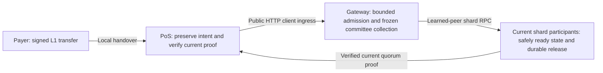
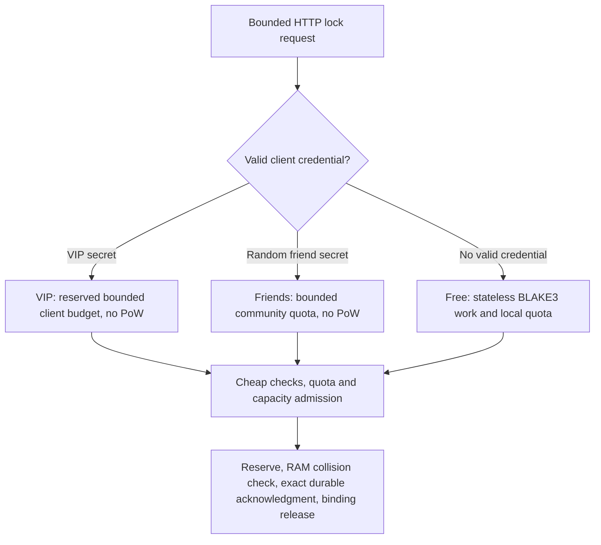

# 13. Client Ingress, Access Tiers and Stateless Load Protection

> **Status:** Selected requirements; implementation and executed evidence are tracked separately.
>
> **Authority:** English repository specification. See [invariant registry](INVARIANT_REGISTRY.md), [consolidation](ARCHITECTURE_CONSOLIDATION.md) and Spec 16 acceptance gates.

Public HTTP ingress serves wallets and PoS clients. Its VIP, Friends and Free tiers control resource admission, not consensus authority. Public clients need no P2P friendship. Internal QUIC F2F gossip and learned-peer shard RPC are separate interfaces; a full node uses shard RPC directly, never another node's public HTTP API as a client to gain ingress privileges.

## 1. Checkout responsibilities and timing

The payer supplies the signed L1 transfer to the recipient, for example by NFC, BLE or QR. The merchant/recipient obtains and fully verifies the current L2 checkout proof before releasing goods; a successful HTTP flag, matching single lock or cheap status result is insufficient. L1 carries the voucher, transaction and causal history. Clients do not recursively archive historical L2 quorum bundles.



FINAL needs 14 distinct valid current members of one frozen committee of at most 20; no rank21 replacement. Collection has an 800 ms budget and may fail earlier when quorum becomes impossible. Local durable processing targets <20 ms; it is not a measured promise or end-to-end checkout SLA. Resource isolation reduces interference but cannot guarantee latency under arbitrary load, disk stalls or network failure.

## 2. Three client access tiers



| Tier | Intended clients | Credential | Work and accounting |
| --- | --- | --- | --- |
| VIP / merchant | PoS terminals and contracted clients | Private client bearer/API credential with local hashed account record | No PoW; booked Byte-Years/request quota and bounded reserved capacity. |
| Friends / community | Friends, family and own PoS terminals | Independently generated random 128-bit secret, represented as `f2f_<hex>` | No PoW; bounded free/community quota. |
| Free / public | Any client without registration | None required | Stateless BLAKE3 Hashcash, physical-time rate limiting and capacity feedback. |

The term client Friends grants no QUIC gossip right. NodePubKey, HRW ticket, IP address, learned peer status or P2P trust list is never an ingress bearer token. Friend secrets must not be derived from publicly gossiped keys. Client credentials are revocable locally without changing node identity or consensus membership.

Exact reservations are configured and measured, not guaranteed 70–80% CPU or <50/<100 ms tier latencies. Protect internal inbound shard service and bounded recovery progress in addition to the client-tier budgets; client priority never consumes unlimited internal capacity.

## 3. Private local client registry

The registry stores a blinded/hashed account tag, access tier, credential validity and bounded accounting/rate-limit counters. It does not require names, persistent IP-address histories or raw public identity keys for billing. Account tags are pseudonymous local accounting identifiers, not a zero-knowledge proof or anonymity against traffic analysis. Credential hashing uses canonical length-prefixed domain separation and secret input; exact encoding belongs to the shared schema, not a new public-key handshake invented here.

For an ingress friend, authenticate the private random bearer credential through the HTTP client API, not a node-to-node QUIC identity signature. Keep raw secrets out of metrics and logs. VIP provisioning, quota topups and revocation use the private local control boundary; monetary billing belongs to external periphery.

A registry entry may carry these fields without introducing new consensus state:

| Field | Purpose |
| --- | --- |
| 32-byte account tag | Local hashed credential/account lookup. |
| Access tier and validity bound | Local authorization; independent of shard authority. |
| Remaining micro Byte-Years | Root-derived storage-time accounting. |
| Request-rate/burst counters | Bounded admission with physical-time decay. |

Quota comparisons do not prove peer fraud or alter passive heartbeat presence. All registry, dashboard and metric aliases remain operator-private (DEC-077); public gateway advertisements disclose only their intended discovery data.

## 4. Free tier: direct stateless BLAKE3 Hashcash

Ticket mining uses Argon2d in its separate lifecycle. Public request filtering uses BLAKE3 to avoid forcing expensive asymmetric or memory-hard verification on every untrusted input.

For the accepted ten-minute time window, use the canonical puzzle from AGENTS.md:

```text
epoch_slot = justified_now_sec / 600
h = BLAKE3(len(domain) || "HUMOCO_V1_POW_STATELESS" || parent_lock || epoch_slot || nonce)
accept_work iff LeadingZeros(h) >= required_difficulty
```

`len(domain)` is the canonical one-byte domain-length prefix; integers and fixed fields use the shared checked canonical encoding. Do not add a second `HUMOCO_POW_SOLUTION` hash domain or a stored server challenge. Time validation follows the justified clock/window policy; exact admitted adjacent windows must match that policy, not unsanitized OS time.

The server recomputes work directly. It stores neither `issued_challenges` nor a mandatory `seen_solutions` table. Work verification is constant bounded work for bounded inputs; expected client search grows approximately as `2^difficulty`. The former sub-microsecond cost figures are measurement targets/examples, not executed evidence. Server processing has nonzero costs even under attack.

### 4.1 Adaptive difficulty and feedback

Local load may raise difficulty. If work is insufficient, return `429 Too Many Requests` with `X-Required-Difficulty: <N>` under the interface contract. Preserve these historical illustrative configuration bands without implying fixed solve times or a newly selected deployment default:

| Local queue load | Illustrative difficulty |
| --- | --- |
| Below 50% | Baseline, for example 8 bits. |
| 50%–80% | Baseline +4 bits, for example 12. |
| Above 80% | Baseline +8 bits, for example 16. |

Actual policy/configuration and client performance require measurement. Difficulty pushes additional search to clients; it does not imply the server remains idle or immune to botnets.

Run bounded framing/schema checks, cheap token/work/rate/quota checks and capacity admission before costly asymmetric operations. A valid puzzle grants no exemption from root/lock validation, queue limits or signature verification.

### 4.2 Retry semantics and durable release

An identical retried lock remains idempotent: same lock on the same parent yields the existing success result after its exact durable state is established; a conflicting lock yields 409. A repeated nonce by itself must not turn an identical valid retry into a 409. Rate limits, accepted time windows and current difficulty still apply to admission. The receiver challenge for a live-state proof is a separate replay-defense purpose and remains mandatory for that proof.

Reserve bounded asynchronous disk capacity before RAM mutation. Coalesce identical in-flight work with bounded waiters and total operation budgets; no pending RAM entry or cached signature permits early release. The worker atomically persists the exact lock and own immutable signing decision; await its durable acknowledgment without a RAM guard or unmanaged blocking disk I/O on the runtime/request thread. This includes idempotent replies, status paths that could expose a pending binding approval and gateway self votes. Ordinary read traffic does not commit per query.

Timeout does not roll back a completed lock or establish nonpayment. Preserve committed state and permit exact retries to discover it. Limit batching by time, count and bytes and bound shutdown/drain waits. Ordinary process crash with intact committed storage is covered by durable-before-release; storage loss, stale restore, corruption and unknown rollback remain separately gated. No root-risk markers or automatic identity replacement are introduced.

## 5. Internal reciprocity, pacing and presence

Internal shard requests have their own learned-peer authorization, quotas and protected budgets. Local sender pacing can respect capacity feedback and bound retries without treating refusal as personal misconduct. Ordinary NOT_READY, capacity refusal, normal ephemeral QUIC idle closure and quorum-completion cancellations are neutral. No lower-ranked committee member replaces a refused vote during checkout.

Passive presence suspension follows three consecutive missed hourly F2F heartbeats under its specified timing rules. It is not triggered by HTTP quota comparisons, signing percentages or short shard timeouts. Only verified first-party equivocation authorizes automatic permanent identity sanctions. Pacing does not establish a fault bound or guarantee client migration in <200 ms.

## 6. Canonical ingress invariants

INV-1301–1306 retain their identifiers with these explicit qualifications. INV-1302 means privacy only; Spec 19's former sender-pacing reuse is the legacy alias identified in the registry and now references INV-1307.

1. **[INV-1301] Bounded VIP isolation:** Reserve bounded client service budgets and reject overload promptly. Validate isolation under declared workloads; no universal latency guarantee is implied.
2. **[INV-1302] Private local account tagging:** Use local hashed/pseudonymous account records without required plaintext identities, persistent client IP histories or public node keys as bearer secrets. It is not a cryptographic zero-knowledge claim.
3. **[INV-1303] Stateless Free-tier work:** Derive and verify the direct canonical time-window puzzle without issued-challenge state or a mandatory used-solution table.
4. **[INV-1304] Asymmetric work barrier:** One canonical bounded BLAKE3 puzzle verification versus expected exponential client search; actual performance must be measured.
5. **[INV-1305] Autonomous emergency brake:** Operators may locally raise public-work difficulty and bound anonymous ingress; capacity feedback neither grants consensus authority nor authorizes bans.
6. **[INV-1306] Scoped reciprocal service:** Local internal-service pacing respects actual protocol authorization and capacity limits. Client tokens and P2P identity remain distinct; passive heartbeat presence is not derived from checkout misses or quota refusals.
7. **[INV-1307] Bounded sender pacing and protected internal budgets:** Bound outgoing offered work/retries and protect separately bounded inbound shard-service and sync/recovery budgets from public client/read load. Quota-zone observations remain local diagnostics/backoff, without fraud inference, presence change or identity sanction.

## 7. Acceptance boundary

Require real receiver-side adversarial QUIC checks for internal quotas/admission and malformed traffic, relevant HTTP tier/secret/PoW/overload/retry checks, actual recipient verification of current proofs and real daemon crash/release tests. Every route/alias for private diagnostics needs exposure checks. Spec 16 defines the evidence record; test names and simulations alone establish none of these protections. Authority, source completeness, activation and rollback-recovery arguments remain separate open gates.
