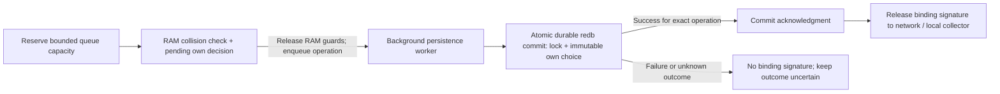

# 14. Node Persistence & redb Storage Architecture

> **Status:** Standard  
> **Model:** Logic & State Graph First  

This document specifies the **persistent disk storage layer** of a Layer-2 shard node. It defines the criteria for separating volatile RAM from NVMe/SSD storage, justifies the choice of the pure-Rust embedded key-value database **`redb`**, and describes the table layouts for **identity, WoT endorsements, ingress accounts, active locks, and slashing proofs (fraud evidence)**.

---

## 1. The Dual-Tier Storage Paradigm

Layer 2 is a blind Collision Lock Registry. Request/runtime threads perform no
blocking disk writes: a bounded asynchronous worker owns persistence.
**Durable-before-Release (DEC-087, restoring DEC-029)** requires the exact
lock and immutable own signing decision to commit atomically and durably before
any binding signature leaves the node or counts as a local quorum vote. Enqueue
success or a RAM entry is insufficient. This normative contract is not a claim
that the inspected production paths already implement or verify it.

```mermaid
flowchart TD
    subgraph StorageArchitecture["Dual-Tier Storage Architecture"]
        direction TB
        subgraph HotTier["Tier 1: Volatile Hot Path (RAM)"]
            RAMEngine["LockStorageEngine (DashMap Hot Cache)"]
            RAMEngine --> FastLock["First-Seen Collision Check (< 1 µs)<br>Volatile LockEntries (192 Bytes)"]
        end

        subgraph PersistentTier["Tier 2: Persistent Safety & Graph Layer (NVMe / SSD via redb)"]
            RedbEngine["redb (Embedded Pure-Rust ACID KV Store)"]
            RedbEngine --> T1["Table: node_identity (Keypair, Genesis, PoW Proof)"]
            RedbEngine --> T2["Table: peers (F2F Friends, Static Addresses & Age)"]
            RedbEngine --> T3["Table: active_locks (Persisted Locks until root.valid_until)"]
            RedbEngine --> T4["Table: fraud_evidence (Slashing Proofs for L1)"]
            RedbEngine --> T5["Table: ingress_accounts (Hashed AccountTags & VIP Quotas)"]
            RedbEngine --> T6["Table: own_signing_choices (Immutable identity/slot/payload/context)"]
        end

        FastLock -.->|Bounded worker: one atomic lock + own-choice transaction| RedbEngine
        RedbEngine -->|Durable per-operation acknowledgment| Release["Binding signature may be released"]
        FastLock -.->|Equivocation Detected! (Asynchronous)| T4
    end
```

---

## 2. Why `redb` as the Persistent Embedded Engine?

In the legacy planning archive *RocksDB* and *Sled* were evaluated. They were discarded for the following reasons:
* **RocksDB:** C++ codebase, binding overhead, compaction stalls, risk of memory bugs.
* **Sled:** Incomplete in the Rust ecosystem and not approved for production use.

### Advantages of `redb` for HuMoCo:
1. **100% Pure Safe Rust:** No C/C++ dependencies, deterministic memory management.
2. **ACID Transactions with MVCC:** Parallel zero-copy read transactions without blocking writers.
3. **Crash Recovery Model:** ACID/CoW supports recovery under the engine and storage-device durability assumptions. Explicit durable commit settings, fault injection and actual power-loss/rollback behavior require verification; no unconditional corruption immunity is claimed.
4. **Zero-Copy Reads:** Returns native byte slices (`&[u8]`) directly from the memory-mapped image.

---

## 3. Persistent redb Tables

```rust
use redb::{TableDefinition, Database};

/// 1. Node Identity & Boot Parameters (1 entry)
pub const TABLE_NODE_IDENTITY: TableDefinition<u8, &[u8]> =
    TableDefinition::new("node_identity");

/// 2. F2F Peers & Friendship Topology
/// Key: 32-byte NodePubKey (node identity) | Value: Serialized PeerRecord (Address, Last-Seen, Uptime)
pub const TABLE_PEERS: TableDefinition<&[u8; 32], &[u8]> =
    TableDefinition::new("peers");

/// 3. Persistent Active Locks (Valid until root.valid_until)
/// Key: 32-byte ParentLockKey | Value: Serialized StoredLock (192 Bytes)
pub const TABLE_ACTIVE_LOCKS: TableDefinition<&[u8; 32], &[u8]> =
    TableDefinition::new("active_locks");

/// 4. Non-Losable Equivocation Slashing Proofs
/// Key: 32-byte CanonHash | Value: Serialized Fraud Proof (Double Signature for L1)
pub const TABLE_FRAUD_EVIDENCE: TableDefinition<&[u8; 32], &[u8]> =
    TableDefinition::new("fraud_evidence");

/// 5. Local Ingress Customer and Friend Registry (Blind Hashed)
/// Key: 32-byte AccountTag | Value: IngressAccountRecord
pub const TABLE_INGRESS_ACCOUNTS: TableDefinition<&[u8; 32], &[u8]> =
    TableDefinition::new("ingress_accounts");

/// 6. Immutable Own Signing Choices (conceptual serialized identity/slot key)
/// Value: exact lock/payload and original approval context, authenticated root TTL
pub const TABLE_OWN_SIGNING_CHOICES: TableDefinition<&[u8], &[u8]> =
    TableDefinition::new("own_signing_choices");
```

---

## 4. Asynchronous Write Path and Durable Signature Release

The table names and layouts above are conceptual specification interfaces;
exact key encoding and integration remain implementation work. Original approvals
bind full identity, network, consumed-output slot, exact lock/payload and signed
context. They are not replaced by a synced record or a later canonical winner.



1. Run cheap admission checks and reserve bounded persistence capacity before RAM mutation. The atomic RAM collision check establishes a pending local exclusion, not a completed attestation.
2. Compute signature bytes in RAM before or after the commit as convenient, but expose none of the binding signature before durability. Drop RAM guards before asynchronous waiting.
3. The worker commits the exact lock and immutable own choice in the same durable redb transaction. Batching multiple operations is permitted; acknowledge each operation only after its complete transaction succeeds. Preserve exact original approval/context under the selected own-approval retention policy.
4. The handler awaits that acknowledgment. This applies to QUIC replies, HTTP responses, idempotent fast paths and gateway self votes. A failed/closed completion channel, timeout, serialization drop, write failure or unknown commit outcome never yields a signature or confirmed success. Persistent failure gates all dependent signing scopes.
5. A cancelled requester does not roll back committed state. A commit may succeed after the request deadline; preserve it and let exact retries reconcile. No extra payment queue or detached unbounded retry work is introduced.
6. Ordinary process crash with intact durable storage has two cases: before commit no binding signature escaped; after commit the lock and own choice are recoverable, even if the response was lost. No root-risk marker, bucket quarantine or identity abandonment is required for this crash window.
7. Expected local storage latency of 1–5 ms is an unmeasured engineering target. Include worker/batch queueing and commit time in the existing 800 ms gateway collection budget; safety never falls back to RAM-only release on a slow disk. Actual root-expiry rules remain in force; commit completion cannot authorize a new vote on an expired root. This does not renew the wallet's entry-only freshness window.

Own choices remain immutable across canonical merges and live-state reads, and
are physically pruned with their authenticated root lifetime plus 30 s. Live-state
responses have their separate read purpose and challenge binding; they do not
create original approvals or require a disk write per read. A pending uncommitted
lock cannot be promoted through status/self-signing into a countable durable
current-state confirmation. Already installed safe state remains the read basis.
Fraud-evidence persistence retains INV-1402 and its separate lifecycle; unrelated
evidence need not enter the lock+own-choice transaction.

---

### 4.1 Bounded batching and operation lifecycle (DEC-088)

- Seal a batch on bounded age/time, item count or bytes, whichever occurs first;
  single-operation load must not wait indefinitely for batch fullness. Numeric
  defaults require measured sizing rather than a new unapproved latency promise.
- Coalesce identical in-flight operations by exact signed payload/context, with
  bounded waiters and memory. Do not coalesce incompatible outputs/decisions or
  create unbounded detached work when a client retries or disconnects.
- Bound queue admission, commit-ack waiting and shutdown drain. Failure, timeout,
  unknown commit, closed channel or a late reply never manufactures a signature.
  Preserve successful late commits; there is no automatic rollback on client timeout.
- Protect inbound shard service and required P2P sync from public ingress pressure
  through bounded separately reserved work/queue budgets (INV-1307). A priority
  label alone is insufficient if one shared queue can exhaust all capacity.
- Stop admission during shutdown, drain accepted work until the original fixed
  deadline, and report honest completion/failure. Repeated ordinary signals do not
  reset the drain or bypass durability. Stop success requires actual process exit
  and database-lock release (DEC-074–076), not merely an accepted stop request.
- Private bounded metrics record queue/batch/commit/ack latency, waiters and failures.
  Separate CPU collision time from durable response and full checkout latency;
  no performance target weakens the barrier. Detailed logs stay with the OS.

These are accepted future implementation requirements. Their existence in this
specification does not attest current queue isolation, deadline enforcement,
coalescing, durable storage settings or measured throughput.

## 5. Crash Recovery & Node Restart

When a node restarts after a failure:
1. **Load Identity:** `TABLE_NODE_IDENTITY` provides the Ed25519 secret key and the genesis $T_0$ parameter.
2. **Restore Topology:** `TABLE_PEERS` restores active F2F friendship and neighborhood connections.
3. **Load Active Locks and Own Choices:** Restore non-expired collision state and the immutable own signing decisions before binding signing is enabled. Ordinary crashes do not erase decisions whose signatures were released under §4.
4. **Co-Shard Resync:** Reconcile relevant missed state under the selected per-shard readiness and demand-triggered recovery rules. Restoring own choices does not replace safe shard-state recovery, and receiving shared state does not overwrite own choices. Actual corruption, lost storage, unknown rollback or copied signer state is outside the intact-storage process-crash argument and never authorizes an empty-state reset or signing without justified safety.
5. **Pending Fraud Evidence:** Retain verified pending evidence and expose it through the authorized protocol/integration path. L1 submission and its success are separate delivery obligations, not assumed executed behavior.

---

## 6. Invariants of the Persistence Layer

1. **[INV-1401] Asynchronous I/O, Durable-before-Release:** Blocking redb work runs in the bounded worker. Binding signature release awaits the exact successful durable commit without holding RAM guards. Commit latency remains part of response latency.
2. **[INV-1402] Non-Losability of Slashing Proofs:** Every valid equivocation fraud proof must be persisted to `TABLE_FRAUD_EVIDENCE` before being discarded from RAM.
3. **[INV-1403] Pure-Rust Persistence:** Only safe pure-Rust engines without external native C/C++ libraries are permitted for local data storage.
4. **[INV-1404] Deterministic Restart:** Restore retained own choices and active collision state; issue votes only after the affected shard's recovery/readiness conditions are satisfied. Ordinary intact-storage restart needs no special lost-volatile-vote quarantine.
5. **[INV-1405] Atomic Lock and Own-Choice Commit:** Every released original approval has its exact lock and immutable identity/slot decision in one successful durable transaction. Existing identical choices are idempotent; incompatible own choices cannot be overwritten by sync, merge or retry.
6. **[INV-1406] No Release Through Pending Paths:** Enqueued/RAM-only entries, duplicate requests, read paths and self votes cannot bypass the durable-release gate. Failure and uncertain outcomes never manufacture a vote.

## 7. Required Crash and Wire Verification

These are acceptance obligations, not executed evidence: kill the daemon before
commit and verify no binding signature escaped over real QUIC; kill after commit
before/during response and recover the exact decision; retry idempotently and
reject a fresh conflicting spend of the same output in a later bucket. Exercise
simultaneous duplicates, local self votes, slow/failed/unknown commits, cancellation,
shutdown drain expiry and RAM guards during worker I/O. An uncommitted lock must
not obtain a countable live confirmation. Verify actual durable acknowledgment
and automatic recovery, not a test that manually flips readiness. Power-loss
durability, storage failure/rollback assumptions and latency require their own
evidence; neither 1–5 ms nor universal recovery is established by this document.
