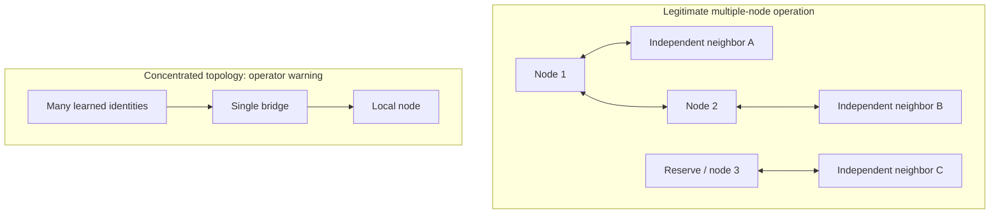
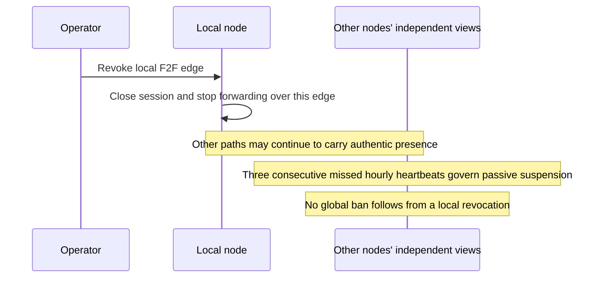

# 17. Private Topology Telemetry and Operator Diagnostics

> **Status:** Operational requirements; implementation and executed evidence remain separately tracked.
>
> **Principle:** Telemetry informs human operators; it never becomes voting authority or automatic evidence of misconduct. See [invariant registry](INVARIANT_REGISTRY.md), [consolidation](ARCHITECTURE_CONSOLIDATION.md) and Spec 16.

This document describes the operator's local topology view, compact dashboard and diagnostic warnings. Metrics, topology and dashboard data remain private under DEC-077. Public gateway discovery is a separate intentionally public HTTP directory/advertisement function; it does not expose diagnostic graphs, metric histories, friend lists, account data or the control plane.

## 1. Observations and authority

A local observation can explain overload, clock disagreement, topology concentration or poor service. It cannot prove a remote node lied, establish a global network view or authorize a cryptographic ban. Permanent identity/ticket/Web-of-Trust sanctions require verified first-party equivocation evidence under the fraud protocol; telemetry does not create an L1 tombstone.

Operators retain the choice to maintain or revoke their own F2F relationships. A human's local edge revocation is not a globally authoritative accusation. No diagnostic metric automatically changes HRW membership, freezes funds, broadcasts hearsay or counts as a committee vote.

## 2. Legitimate multiple-node operation and topology concentration

One operator may run multiple nodes, including cold reserves, subject to ordinary ticket admission, maturation and service rules. Independent connections improve practical resilience. A node is neither malicious solely because it shares an operator nor cryptographically safe solely because it has three edges.



A concentrated bridge can censor or disconnect a local view and deserves investigation. Neither a >99.9% drop claim nor “all bots remain immature” is established by the diagram. Ticket mining is Argon2d with its 24-hour incubation; it is distinct from passive presence. Admission assumptions and bounds on coordinated adversaries remain separate design/proof obligations.

## 3. Local revocation, presence and cleanup



A node isolated from all authentic heartbeat paths is suspended in each local view according to the selected three consecutive missed hourly heartbeat rule. Exact timing depends on the heartbeat schedule and specified window handling. Ticket 24-hour maturation and phase stability hysteresis do not impose 8–16h or 21–24h offline detection. Transport idle closure, shard RPC timeouts, NOT_READY and quorum-cancelled work do not substitute for missed heartbeat evidence.

Bounded stale peer-metadata cleanup is an operational lifecycle concern; it must not erase protected live lock state or own signing decisions. A historical 48-hour peer-cache cleanup example is not an active-lock expiry rule or a proven global removal deadline. Root-bound lock/own-choice expiry remains `root.valid_until + 30s` under justified time and safe retention rules.

## 4. Private interfaces and bounded metrics

Expose diagnostics through the private local operator boundary, for example the UNIX control socket `/tmp/humoco.sock` or an explicitly protected local administrative listener. Private access must apply to **every alias, nested route, alternate listener and dashboard asset**, including `/metrics`, topology paths and any renamed versions. P2P friendship does not automatically authorize dashboard access. Route names, obscurity or a UI hiding a link do not establish privacy.

The dashboard remains a compact offline diagnostic window (<128 KiB), without remote runtime dependencies, unbounded histories, web log buffers, live stderr streaming, terminal emulation, browser backup controls or manual TTL-prune buttons. Logs belong to OS stdout/stderr and `systemd`/`journalctl`; backups belong to scripts/cron through local control. Metric history uses bounded retention/cardinality and aggregation. Do not expose raw client secrets or per-client identity histories.

### 4.1 Example local metric vocabulary

These are useful diagnostic names, not claims every exporter or label is implemented:

| Metric | Type | Local meaning |
| --- | --- | --- |
| `humoco_active_nodes_total` | Gauge | Active identities in this node's learned view; not globally counted truth. |
| `humoco_peer_connections` | Gauge | Direct F2F and ephemeral shard sessions, with lifecycles distinguishable. |
| `humoco_edge_inbound_rate` | Bounded counter/rate | Received heartbeat volume by retained local edge, with cardinality limits. |
| `humoco_edge_red_drop_rate` | Bounded counter/rate | Observed local overloaded-edge drops; not proof that a remote peer is malicious. |
| `humoco_immature_nodes` | Gauge | Locally known tickets within incubation; independent of offline detection. |
| `humoco_pos_latency_seconds` | Histogram | Measured checkout or local processing stage, explicitly labeled by its meaning. |
| Durable queue/commit indicators | Bounded gauges/histograms | Pending work, commit latency, failures and incomplete drain; no early signature permission. |

### 4.2 Private topology output

A local JSON graph may contain the node's identity, known edges and advisory messages. Example warnings:

```json
{
  "scope": "private_local_view",
  "warnings": [
    {"level": "WARN_TOPOLOGY_CONCENTRATION", "message": "Many identities currently arrive over one bridge; inspect independent paths."},
    {"level": "WARN_SINGLE_EDGE_CENSORSHIP_RISK", "message": "Only one F2F edge is available; additional independent paths may improve resilience."},
    {"level": "WARN_LOCAL_CLOCK_SKEW", "message": "Local clock differs from the neighbor median; inspect time configuration."}
  ]
}
```

A clock warning does not automatically adjust OS time, override P2pClock validation or punish a peer. Exact clock acceptance and bounded correction are separate protocol rules.

### 4.3 Ingress and neighbor diagnostics

An optional local warning near 80% of a new neighbor's daily budget may prompt inspection of a legitimate merchant event versus unexpected load. The threshold is a diagnostic example, not an automatic denial, ban or declaration that a certain voucher count is suspicious. Derive displayed counts from the actual authenticated root lifetimes and accounting policy; do not invent fixed 333-voucher capacity.

Quota comparisons (including Spec 09's 75%/125% zones) support bounded local sender backoff only. They never change passive presence `missing_count`, declare fraud or supply voting authority. Observations remain private; no reputation-rumor gossip or public pillory is added.

### 4.4 Local shard-service diagnostics

An optional warning such as `WARN_LOCAL_SHARD_PERFORMANCE_DEGRADED` can report a low observed service ratio (for example 42%) and suggest checking I/O queues, CPU, network loss and sync-readiness. There is no invented “peering credits expire” penalty. A diagnostic threshold such as 80% must be labeled with measurement window/denominator and does not establish protocol misconduct.

Frozen checkout membership remains at most 20 distinct identities and FINAL requires 14 verified voices. No rank21 replacement, automatic signing-percentage exclusion or guaranteed successful checkout follows from diagnostics. NOT_READY, capacity refusal and cancelled stragglers are neutral; all missing votes consume the existing quorum headroom.

## 5. Canonical telemetry invariants

1. **[INV-1701] Non-authoritative telemetry:** Diagnostic observations inform human operators only. They never automatically ban, slash, authorize committee membership or override protocol admission/presence. Verified first-party fraud is a separate enforcement path.
2. **[INV-1702] Legitimate multiple-node operation:** Multiple nodes per operator are allowed under ordinary admission/ticket rules. Independent edges support resilience, but neither common ownership nor a three-edge count determines cryptographic honesty/security.
3. **[INV-1703] Local revocation and passive presence:** Local edge removal affects that edge; three consecutive missed hourly heartbeats govern suspension in each local view. No automatic global sanction or fixed 8–16h/24h removal guarantee follows.
4. **[INV-1704] Private ingress transparency:** Bounded private indicators expose observed direct-neighbor load for operator diagnosis, without public blame, fraud inference or identity/presence penalties.
5. **[INV-1705] Private shard-service transparency:** Bounded private self-diagnostics reveal service degradation and durable-processing delays. They never replace quorum proof, reduce its threshold or authorize early signatures.

## 6. Evidence boundary

Verify private exposure across all routes/aliases/listeners with actual HTTP/control tests and verify that diagnostic values cannot feed identity sanctions or membership decisions. Test genuine fraud separately over real QUIC. Validate passive presence against authentic hourly heartbeats, not manually manufactured checkout failures. Measure bounded history/cardinality and private dashboard size. This consolidation states acceptance requirements; it runs none of these tests and closes no admission or transition safety proof.
