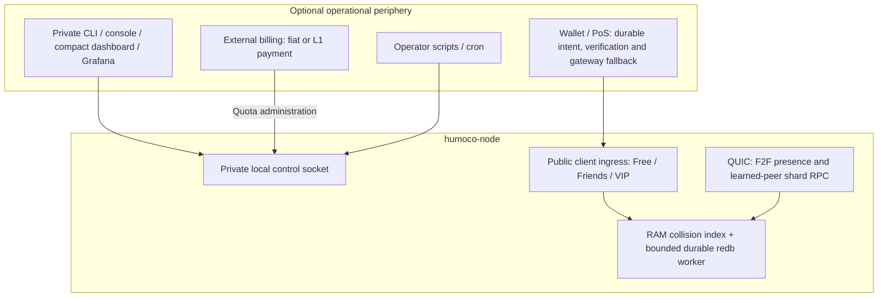
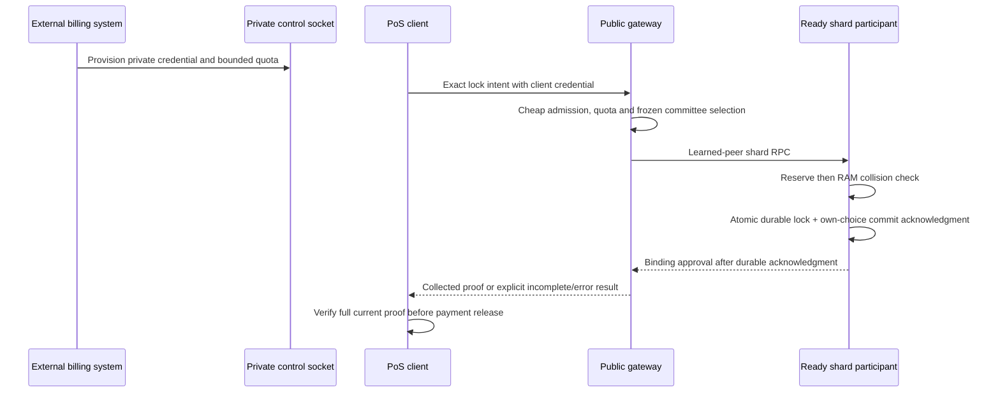

# 20. Operations, Ecosystem and Future Evolution

> **Status:** Architecture and operational requirements; targets are not measured delivery claims.
>
> **Scope:** Node operation, merchant integration, accounting, resilience and deliberate protocol evolution. See [invariant registry](INVARIANT_REGISTRY.md), [consolidation](ARCHITECTURE_CONSOLIDATION.md), Specs 13/14/16/17 and DEC-074–089.

The Collision Lock Registry keeps consensus work separate from administration, monetary billing and diagnostic tooling. L1 carries the transaction, voucher and causal history. L2 retains active collision state and separate own signing-safety decisions; current participants supply current live-state evidence. No client or successor node must archive generations of departed signers' quorum bundles.

## 1. Core and periphery



Administrative and billing complexity belongs outside the consensus path. Public HTTP ingress remains part of the node's defined service; this boundary is not a ban on its HTTP server. Optional richer external tools must not turn the compact diagnostic dashboard into an operating-system shell or backup orchestrator.

## 2. Private control and observability

The local UNIX control socket, for example `/tmp/humoco.sock`, is the primary administrative boundary. A configured local network listener must have equivalent explicit access protection; loopback/location alone is not authorization for unrelated users. Command names such as status, peers, quota and drain describe capabilities, not proof of a particular implemented API schema.

| Facility | Intended use | Boundary |
| --- | --- | --- |
| CLI / console | Direct node status, peer and quota administration | Local operator control; no automatic updates or remote operator veto bypass. |
| Prometheus/OpenMetrics | Bounded counters and latency histograms | All metric aliases/routes/listeners private, including `/metrics`. |
| Topology/dashboard | Compact offline local diagnosis | All graph, asset and nested aliases private; <128 KiB diagnostic window, no remote dependencies or web log buffers. |
| Logging | Operational event/trace output | OS stdout/stderr and `systemd`/`journalctl`; no unbounded browser log retention. |
| Backup/maintenance scripts | Operator-scheduled tasks via local control | External scripts/cron, no browser backup or manual TTL-prune buttons. |

Useful private measurements include active lock count, checkout/local-stage latency, connected F2F and ephemeral shard sessions, rejected ingress, pending durable operations, commit acknowledgment latency and drain outcome. Define stage, units, bounded cardinality/history and measurement windows. Telemetry is not evidence for bans, automatic peer exclusion or voting authority (INV-1701).

A public gateway directory is an intentional separate surface. Advertisements describe gateway HTTP reachability and the intended supported client service; they do not publish the private diagnostic/control plane or grant F2F/shard membership. Their exact advertisement schema and authentication/validity checks remain shared-protocol delivery work. Gateways do not provide server-side stale-result fallback. Cached directory fallback belongs exclusively to client logic, subject to validation and bounded freshness/retry policy.

## 3. Blind client accounting and VIP service

Nodes know no client currency balances or monetary L2 fees. They account in Byte-Years (Spec 09) and request budgets. Commercial billing and payment processing stay in external periphery, which administers local quota through the private control socket.



The node's <20 ms local durable processing goal is a target requiring measurement. It is not the entire checkout SLA or a guaranteed redb/fsync time. The frozen write collection budget is 800 ms; successful end-to-end service depends on sufficient ready current members and transport conditions. Fourteen verified distinct voices are required for FINAL; capacity/NOT_READY/failure all share the existing six noncontributor slots. No timeout retroactively removes a committed lock.

Client tiers remain distinct from P2P roles:

- **VIP:** Private merchant credential and bounded purchased API/storage-time quota; priority does not authorize undurable release.
- **Friends:** Friends, family and own PoS terminals use independent random 128-bit secrets (`f2f_<hex>`), never node public keys or P2P trust membership.
- **Free:** Permissionless client access with direct stateless BLAKE3 Hashcash and bounded admission/load feedback.

Full nodes participate through internal shard RPC; they do not enroll their public keys as HTTP clients to bypass PoW. Normal status queries remain cheap at `read_quorum=1`; recipient payment release requires the actually verified current quorum proof. Private metrics remain private even when public gateway discovery is enabled.

## 4. Multiple nodes and client resilience

Operating multiple nodes can reduce particular failure risks but does not establish 99.999% uptime or independent Byzantine identities merely by node count. Model correlated operator, hosting, network, power and admission failures. Multiple nodes participate as ordinary peers under the same ticket and membership rules. They need no additional Raft/Paxos cluster service as part of this design; shard synchronization still needs its separate safety/coverage justification.

Clients may keep several public HTTP gateways:

```text
Gateways = [https://gateway-a.example, https://gateway-b.example, https://gateway-c.example]
```

The client preserves its exact durable intent and pending output before sending and uses the selected bounded retry/follow-up policy (DEC-042/060/071). It verifies actual proof, not gateway claims. Discovery and optional cached fallback supply candidate gateways only; they do not prove shard authority or successful payment. Do not add an unconditional 10 ms duplicate-send rule, guaranteed <200 ms migration, fresh substitute spend or server-side payment queue. Identical retries remain idempotent; a completed commit is retained despite a timeout.

## 5. Restart, recovery and backup boundaries

### 5.1 Ordinary process crash with intact committed storage

Before any binding signature, response envelope or local vote is released, the exact lock and own immutable signing decision must be atomically durable. Use the bounded asynchronous persistence worker and await its exact acknowledgment without holding RAM guards or blocking the request/runtime thread on disk I/O. Pending duplicates, status paths and gateway self votes cannot bypass this barrier.

Before commit no binding approval has escaped; after commit the choice is recoverable from intact storage. This closes the ordinary issued-but-unflushed crash window without root-risk markers, crash quarantine or automatic identity replacement. Readiness still requires safe per-shard state and current authority; retained records do not alone prove every assigned shard complete.

### 5.2 Actual data loss, stale restore and rollback

Hardware loss, corruption, an old backup or unknown rollback differ from ordinary process death. Do not restart the same identity with empty state and sign immediately. The affected scope stays gated until safe relevant state and own-signing safety are justified. Ordinary peer sync need not reconstruct every lost own individual choice; exact recovery for actual loss/rollback remains an open design/proof boundary. There is no automatic abandonment/replacement of identity as a purported universal repair.

Client custody of L1 history and multiple replica copies improve recoverability but cannot exclude data loss if all necessary copies disappear. There is no “three peers in <500 ms” recovery guarantee. Replica counts, source independence, active-root coverage and own-choice recoverability require actual evidence.

### 5.3 Demand-driven shard synchronization

A newly assigned shard is NOT_READY. Authorized relevant demand may admit one bounded recovery job per shard, with bounded total concurrency and retries; no proactive sweep or node-side payment waiting queue is required. Existing ready shards continue independently. Incomplete replicas may serve bounded retained data to authorized learned peers without counting as authoritative ready witnesses.

Snapshot plus bounded deltas must cover the full active root lifetime, including >24h unexpired locks and the 30-second grace, validate canonical/owner/root integrity and install durably before activation. Digest agreement does not prove source completeness; incomplete new replicas cannot validate each other circularly. Account for 8+6+6 split state without assuming 14 identical whole-state digests. Historical quorum archives and predecessor-committee permission do not solve or become prerequisites for this proof.

### 5.4 Stop and service management

Use `systemd` or the OS supervisor for routine daemon management. Graceful stop has one bounded drain deadline; repeated ordinary signals preserve it. A longer supervisor fallback may force termination. Report clean versus incomplete/forced termination honestly; no binding release without successful commit.

The default CLI stop flow waits for actual process exit and database lock release, not merely request acknowledgment. Verify reopening the database independently. Operators retain veto over updates and configuration. Backup/restore scripts use private local control and must preserve the actual rollback/signing-safety gate rather than treating a copied database as automatically safe.

## 6. Deliberate cryptographic evolution

Canonical length-prefixed domain separation and a focused shared encoding/crypto layer support explicit protocol evolution. Current BLAKE3/Ed25519 wire sizes and verification rules remain precise; checked safe parsing and bounded frames apply. Do not claim existing fixed fields already accommodate every future signature or that wrappers alone prevent a network split.

| Concern | Current requirement | Future design boundary |
| --- | --- | --- |
| Algorithm/version identification | Authenticate purpose, network, version and exact schema | A future suite identifier or post-quantum scheme needs an explicit agreed format/migration; no particular reserved `crypto_suite_id` byte is guaranteed here. |
| Domain separation | Canonical one-byte length prefix plus protocol domain and bounded canonical fields | Different versions/purposes must not be interchangeable. |
| Signature/hash abstraction | Keep shared canonical validation coherent across node/client consumers | New sizes, keys, proof costs and compatibility require review and adversarial tests; no automatic quantum-safety claim. |
| Operator sovereignty | No automatic updates; explicit operator control | Deliberate migration must account for mixed versions and refusal without inventing a guaranteed seamless upgrade. |

## 7. Module and evidence map

The actual repository separates `config.rs`, `identity.rs`, `daemon.rs`, `storage/`, `network/`, `ingress/`, `api/`, `control/` and `cli.rs` beneath `crates/humoco-node/src/`; pure logic remains in `humoco-sim-core`. This describes responsibility boundaries, not a second proposed directory tree or proof that every selected behavior is implemented.

Spec 16 supplies acceptance gates: real receiving-shard QUIC rejection and automatic readiness, relevant HTTP/client proof validation, private-route/alias checks, durable release/crash ordering and actual process/database lifecycle. Record selected requirement, design/proof, inspected implementation and executed verification independently. Numeric targets and diagrams in this document do not close current-authority, complete-source/activation, clock/seal or rollback recovery arguments. This consolidation executes no tests and claims no universal availability or recovery guarantee.
