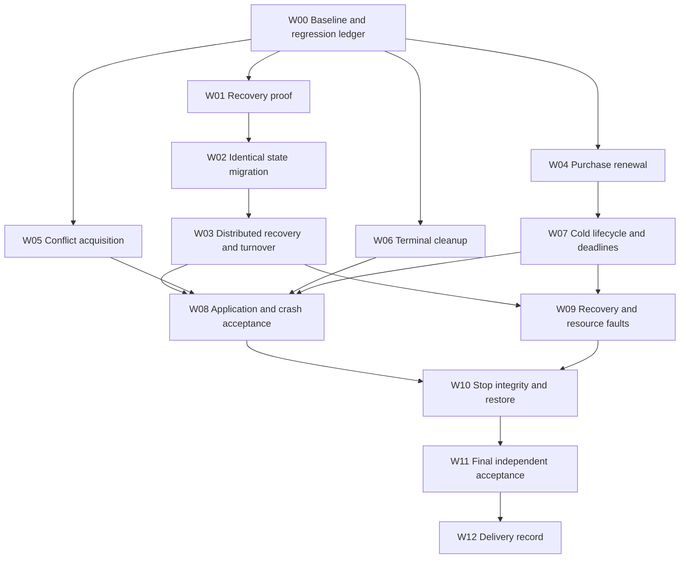

# Remaining architecture implementation and acceptance plan — 2026-10-24

**Status: planning complete; implementation not started under this plan.**

This plan addresses the independent [2026-10-24 audit](ARCHITECTURE_IMPLEMENTATION_AUDIT_2026-10-24.md), findings IA01–IA06, and every remaining Z00–Z14 / G1–G5 / E01–E15 acceptance obligation. It supersedes remaining-work ordering and closure claims in the earlier remediation progress record. It does not replace selected architectural decisions, declare an unproved recovery algorithm correct, or authorize deployment, publication, agent starts or Git commits.

The maintainer requested a detailed plan. Creating this document changes no product code. Implementation should follow this plan when subsequently requested, preserving unrelated work and the audit evidence.

## 1. Baseline, scope and non-negotiable decisions

### 1.1 Inspected starting point

| Repository | Branch | Full HEAD |
| --- | --- | --- |
| `/home/basti/Coding/humoco/human-money-node` | `dev` | `160e9a98ec6b00a0fb20969a4bd415a385868eae` |
| `/home/basti/Coding/humoco/human-money-core` | `live` | `43ee99867e449dfdca868b886f7887d15a38be51` |
| `/home/basti/Coding/humoco/human-money-app` | `dev` | `f62d5bac4b0024287eddf397aa78182045f30980` |
| `/home/basti/Coding/humoco/humoco-proto` | `dev` | `3fc5dd87c82b91e7b682eabcf88e5b5ce23e7c32` |

At planning time the audit report is modified and its evidence directory is untracked in Node. Core has 14,535 existing untracked fuzz/build/cache paths. App and Proto product trees are clean. Preserve all of this. Repeat the inventory before implementation; these hashes are identifiers, not instructions to reset.

App's ignored Cargo patches select sibling Core despite its Git `master` manifest dependency. Node and Core select sibling Proto. Tests must record the actually resolved graph and dirty-file hashes. Do not certify published dependencies from a local override pass.

The audit baseline passed Node STD (675 tests, 14 ignored), Core Nextest (832 tests, seven skipped), App's full script (184 frontend tests plus backend checks), Proto (17 tests), strict lints, three separately executed merge simulations and the current module integration harness. Those results are historical after the first product edit. Audit scripts intentionally exit successfully when they reproduce defects; preserve them and add independent positive regression tests instead of relabeling their exit status as a repair.

### 1.2 Decisions to preserve throughout

- Preserve L1 transaction serialization, canonical hashing and SST signatures. `ds_tag` stays the existing length-prefixed SHA3-256 formula over the previous canonical transaction hash and sender ephemeral public key. It is not Base58(previous transaction ID).
- Keep receiver/change branches independently spendable. Additional L2 causality remains separately author-signed/versioned metadata. Genesis remains only a Voucher Root Anchor in `voucher_roots`.
- Keep Durable-before-Vote for every binding original, live or recovery statement. Reserve bounded capacity before mutation/allocation; no RAM guard across disk waits.
- Preserve independently authenticated recipient-configured regional views and their explicit conditional fault assumptions; require 14 distinct members of the exact current top-20 for FINAL. No rank-21 substitution or threshold reduction.
- Keep explicit operator bootstrap. An ordinary empty join/restart is not complete; recovering self does not become a ready source by possessing a file.
- Preserve class2 > class1 > class0 with justified admission and same-class canonical tie-breaking. Missing support does not establish that an exclusion may be discarded. Own original choices remain separate from current canonical state.
- Keep original send bytes, consumed output identity and signed wallet T0 unchanged through retries. Reconciliation cannot automatically create a replacement payment or refund.
- Keep roster renewal outside payment handling, the selected 800ms checkout budget, and a distinct bounded background reconciliation budget. Entry freshness is not rechecked as a new wallet gate after an admitted durable wait.
- Keep root TTL immutable and purge applicable Node state at root+30s. Recipient completed-purchase replay records are client business state; they are not Node tombstones and must not be deleted casually to recover capacity.
- Preserve G5's achievable boundary: detectable corruption and contradictory first-party self-evidence stop signing. A consistent offline full-directory rollback without independent evidence remains outside the local guarantee.
- Add no TPM, notary, checkout pre-signing network dependency, lock-gossip stream, historical quorum archive, predecessor committee veto or hearsay sanction. Cold shard-direct recovery work is distinct from a new checkout round.
- Keep offline L1 functionality and explicit merchant risk decisions. Software release authorization cannot guarantee exactly-once action by an uninstrumented physical cashier/device.

## 2. Delivery sequence and ownership

Work packages W00–W12 are bounded engineering/review increments, not promised agent runs. No subagents are started by this plan. If delegation is later requested, follow current repository authorization rules; do not infer permission from older orchestration tables.

| Order | Package | Main owner | Depends on | Closes or contributes to |
| --- | --- | --- | --- | --- |
| 1 | W00 — Baseline and executable regression ledger | All repositories / Node evidence | None | Z00, IA06 |
| 2 | W01 — Recovery proof and protocol worksheet | Node / Core simulation rules / shared protocol where needed | W00 | IA01, G2/G3 |
| 3 | W02 — Identical-state support migration | Node | W01 applicable proof section | IA01 immediate failure, Z03/Z07, E04/E05 |
| 4 | W03 — Distributed recovery and turnover | Node / Proto only for shared wire changes | W01/W02 | IA01 remainder, Z02/Z06/Z07 |
| 5 | W04 — Purchase challenge renewal | Core + App bridge/UI | W00 | IA02, E01/E02/E10 |
| 6 | W05 — Productive conflicting-choice reconciliation | Core + App + Node read/live interfaces | W00; W03 for composed merge acceptance | IA03, Z08/Z10, E07/E09 |
| 7 | W06 — Terminal cleanup and worker lifecycle | Core + App | W00; W05 for composed lifecycle | IA04, Z08/Z10/Z13, E12 |
| 8 | W07 — Cold authority lifecycle and shared deadlines | App + Core verification boundary | W00/W04 | IA05, G1/G4, E10/E11 |
| 9 | W08 — Real application and crash acceptance | App + Core + Node harness | W02–W07 as applicable | IA06, E01/E02/E07/E09/E10 |
| 10 | W09 — Resource, freeze and recovery fault acceptance | Node | W02/W03; W07 for checkout measurements | IA06, E03/E04/E05/E08/E11/E12 |
| 11 | W10 — Real stop, integrity, expiry and restore acceptance | Node + Core/App restore boundaries | W03/W06; W08 test infrastructure | IA06, G4/G5, E12–E15 |
| 12 | W11 — Final graph, documentation and independent acceptance | All repositories | W00–W10 | Z14, IA06, all E rows |
| 13 | W12 — Delivery record | All repositories | W11 | Reviewable final scope, source and limits |

W04/W06 can be implemented while the recovery proof is being resolved, without declaring the whole architecture complete. This logical independence does not imply concurrent editing or additional agents. Keep review increments small; a W package may require several code/test changes.

Suggested dependency order:

## 3. Work-package specifications

### W00 — Establish the current source and test ownership ledger

**Targets:** Node evidence/docs; manifests/configs and instructions in all four repositories, read-only until a specific implementation package starts.

1. Read current AGENTS.md, nested applicable instructions, the audit, closure-plan selected requirements, root/causality/bootstrap contract, inherited-support contract and regional-authority/signing-history contract. Resolve historical status claims against code.
2. Capture branch, full HEAD, tracked dirty files, every new path, manifest/lock/config hashes, selected features, toolchain and platform. Include dirty source in file-level hashes. Keep unrelated fuzz/cache artifacts outside delivery changes.
3. Recheck host-filtered locked metadata. Distinguish local Core patches from release/CI resolution. Record source fingerprints in each executed evidence group.
4. Preserve the independent probes. Port the six/seventh-recipient recovery schedule into a maintained real-QUIC test. Split the lifecycle probe into focused tests whose correct outcomes are explicit and independently checkable.
5. Create `docs/evidence/architecture-rest-2026-10-24/` with a machine-readable ledger containing requirement, case ID, command, source fingerprint, expected state, result, premise class and artifact. Record failures and skips, not only passes. Add evidence only when executed.

**Done:** every IA finding has a maintained failure schedule or a precise caller-level integration oracle; the baseline can be reproduced without temporary chat state. Do not run all suites repeatedly for documentary changes.

### W01 — Make recovery's safety and positive-progress argument implementable

**Targets:** `crates/humoco-node/src/daemon.rs::sync_single_shard`, `storage/db/support.rs`, `storage/db/snapshot.rs`, `storage/db/install.rs`, `storage/engine/recovery.rs`, `network/framing.rs`; the distributed/inherited recovery worksheets and applicable simulation tests.

The present worksheet is not a complete algorithm. First produce a concrete state-transition and encoding worksheet, with the following separate claims:

| Claim | Required evidence | Prohibited inference |
| --- | --- | --- |
| Data authenticity | Root/entry/output validation and binding to the cut | Author signature implies quorum confirmation |
| Current witness eligibility | Exact frozen committee, authenticated full identity, ready/healthy source and scoped lease | Any connected responder is a voter |
| Existence | Qualified current commitments to the exact fact/candidate under the selected admission rule | One holder or an unqualified staged union proves admission |
| Omission coverage | Complete authenticated ranges/cuts and a justified coverage rule for potentially live exclusions | An absent key in a partial response proves nonexistence |
| Support inheritance | Exact persisted admitted support and its authenticated qualified admission | `max` of unauthenticated class integers, or own vote implies class2 |
| No-gap activation | Old admitted work drained/accounted for through target commit, publication and readiness | A matching earlier digest remains complete after sources resume writes |
| Positive progress | A stated feasible source/target schedule and bounded completion path | Permanent refusal is completion |

**Required design tasks:**

1. Describe the six-upgrades/seventh-target failure and the complete valid outcome for each subsequent target. Separate objective state agreement from differences in local support representations.
2. Specify how a current qualified quorum can reaffirm the exact same objective state without requiring byte-identical preexisting support metadata. Independently preserve or justify higher inherited class; do not merely remove the support commitment check.
3. Work out AB/A/B with actual identities, target position and source readiness. If an unready target is one of the twenty original holders, removing it can leave only thirteen remote holders for a fact. A twenty-first candidate cannot silently become a twenty-first witness. The test and proof must not hide this arithmetic.
4. Distinguish an intact target's locally retained exclusions from permission to count a fresh ready self-vote. Explicitly state which durable local facts may be preserved and which current attestations must come from eligible remote sources.
5. If bounded candidate reconciliation/re-attestation is required, define who validates a candidate, what coverage it must contain, when it becomes durable, and what exactly is signed. Staging a union of candidates is permitted only as untrusted input; it is not active state or a support certificate.
6. State the positive-progress premises for small meshes and turnover, including cases legitimately contained by NOT_READY. Explain how repeated safe transfers can ultimately replace every original signer without retained original quorum bundles. No static daily tenure or predecessor permission is introduced.
7. Specify conflicting choices, descendants, unknown support, different roots, root expiry, source loss, cancellation, assignment change and contradictory source assertions. Resolution must preserve the approved class/hash order.
8. Freeze fields before wire edits: purpose/version/network, shard, full source/receiver keys, committee context, cut/range identifier, objective and admitted-support binding, challenge/lease, cursor/sequence, completeness markers, limits, errors and legacy-peer behavior. New hashes use registered length-prefixed domains. Reuse existing encodings where their meaning remains correct.
9. State concrete count/byte/disk/work/time reservations. Retain the existing 32-job, 8MiB in-memory reservation and 64KiB-frame ceilings unless a separate selected change exists. They do not by themselves cap staged disk, source scanning work or process RSS.

**Review gate:** demonstrate the claim with independent examples and adversarial counterexamples before changing the productive admission predicate. If selected assumptions do not support a promised schedule, record the exact contradiction and narrow unresolved decision. Continue independent work; do not quietly invent a trust anchor, lower quorum or declare an impossible schedule passing. This plan itself does not assert that one specific per-key or range-proof construction is already proved.

**Done:** a reviewer can calculate witnesses, retained state, disposition, durable writes, admissible signatures and readiness for every example. All unresolved choices are explicit, with their smallest counterexample.

### W02 — Repair identical-state support migration

**Targets:** Node recovery grouping/admission, `VerifiedInheritedCut` or its verified successor, support persistence and installation. Preserve existing status-read-only and fresh-island inheritance fixes.

1. Start with W00's maintained six/seventh-recipient regression in both native and HMC variants.
2. Implement the W01 rule for an agreeing objective state with mixed unknown/class1/class2 support observations. Keep source identity, receiver, network, exact row and root lifetime binding. Replace only the inappropriate aggregate-equality dependency.
3. Make any verified capability constructible only through the checked admission path. The disk installer must reject raw class/status values supplied as evidence by network callers.
4. Preserve stronger exact local/inherited support, immutable own choices, protected omission and same-class ordering. Store support changes atomically with any affected active state/index changes.
5. Verify RAM publication reflects the exact successful durable installation; readiness follows publication. A normal rejected candidate must not be mistaken for uncertain committed state. Cancellation after a blocking commit begins must remain conservatively gated until recovery establishes the state.
6. Audit every earlier import/restart/native/HMC support producer; prevent a repaired sync path leaving a legacy bypass.

**Required maintained tests:**

- All twenty recipients can be processed in the feasible sequential schedule, with multiple rounds and real QUIC, despite intermediate support fragmentation.
- A current quorum of the same objective state supports safe progress; forged support, wrong receiver/network/shard/TTL and insufficient witnesses do not.
- Fresh small-mesh target preserves genuinely inherited class2; ordinary island support cannot newly authorize FINAL checkout.
- Restart and backup/reopen preserve the exact admitted class; raw native FINAL never becomes proof.
- An unknown or stronger live exclusion cannot be omitted/downgraded to make convergence succeed.

**Done:** the old defect probe no longer observes the failure, maintained positive/negative tests pass, and the proof explains both progress and preservation. This closes only the identical-state part of IA01; do not close distributed recovery here.

### W03 — Implement distributed coverage, no-gap transfer and repeated turnover

**Targets:** Node frozen source sessions, bounded snapshot/candidate storage, daemon orchestration, verified admission, installer and real-QUIC recovery suites; shared Proto types only if actually consumed across repositories.

1. Implement the W01 distributed construction in bounded cold shard-direct work. Keep the original frozen committee for the recovery attempt; do not mix arbitrary responder sets to obtain a quorum.
2. Obtain authenticated fixed cuts/ranges and validate all cursors, continuations, scopes and completeness markers. Use disk-backed staging and bounded streaming reduction. Do not rebuild/sort the entire remote database on every page or collect entire cuts in RAM.
3. Build a candidate and verify every admitted row/disposition against existence, coverage and support rules. If candidate endorsement requires another bounded cold recovery phase, implement and test its exact durable/signature boundary. No added round is permitted on the payment signing path.
4. Maintain absolute source leases through the accepted target commit/publication/readiness boundary. Include writes admitted before the freeze but committed afterward in the fence. Define any required delta handling rather than claiming it from a comment.
5. Revalidate the complete ordered assignment, source health, lease/freshness and cancellation state before activation. Late worker completion must not publish stale readiness. Failed staging must leave active safety state unchanged.
6. Keep roots, locks, support, quarantine disposition and indexes in the selected atomic installation transaction. Preserve protected local unknown/confirmed exclusions according to the verified disposition.
7. Add finite source-session cleanup, cursor release, disconnected-target handling and staging-file deletion. Keep own original history independent from synchronized canonical state.

**Acceptance schedules:**

- Real AB/A/B compatible data with the actual 8/6/6 distribution and explicit target/witness premises. No manual post-heal copying or target-readiness injection. Where an initial arrangement lacks sufficient admissible witnesses, verify containment and the selected safe progress phase rather than pretending an initial fact already has fourteen remote witnesses.
- Existing 10-vs-3 and 5-vs-5 scenarios; conflicting same-slot classes and independent compatible slots; unknown support; descendant changes and root expiry during transfer.
- A complete retirement of original signers through successive safe transfers, then a second complete replacement; fresh clients obtain current proof without original signature archives. Responsibility remains computed from the living mesh.
- Insert/delete before cursor, expiry, malformed/duplicate/out-of-order/foreign pages, omitted live rows, source crash/disconnect, assignment change and lease expiry at every phase.
- Target process termination before install, during commit, after durable commit, during RAM publication and immediately before readiness; restart must start closed and converge through the real recovery path.

**Done:** positive progress and refusal cases both pass, each with exact quorum accounting and bounded resources. IA01 closes only when W02 and this package's real scenarios are evidenced.

### W04 — Renew purchase challenges against current authenticated authority

**Targets:** Core `src/app_service/checkout.rs`, private purchase state in `src/models/profile.rs`, App `src-tauri/src/checkout.rs`, receive command/service/UI and checkout tests.

1. Factor common recipient-side construction/validation so initial creation and renewal derive the same immutable voucher/root/output/bundle bindings.
2. For an incomplete purchase, distinguish valid same-authority retry from a new attempt under changed authority or expired challenge. Reuse an existing challenge only while its exact context remains applicable.
3. When renewal is needed, verify the current recipient-owned policy and all configured signed views, compute the exact new committee, generate a new CSPRNG nonce, and durably replace the attempt context and expiry in one wallet transaction.
4. Keep purchase ID, bundle hash, network binding, recipient/output/root identity and root TTL immutable. A network/policy change incompatible with that purchase is an explicit refusal, not an automatic retargeting. A same-network lawful committee change may renew the attempt under the selected current-authority contract.
5. Bind completion to the stored current attempt. A delayed result for the old nonce/committee must fail after renewal. If context equality/nonce is insufficient for safe async cancellation, add a private attempt generation; do not change L1 schemas.
6. Preserve completed replay before network I/O: same ID/bundle returns `newly_committed=false`; different bundle rejects; completion cannot repeat import or software release authorization.
7. Keep stable purchase IDs across retries/navigation as required by the merchant flow. No automatic switch to a fresh purchase ID to work around a failure.

**Tests:** same committee before/after challenge expiry; committee change before and after expiry; renewed B proof succeeds; delayed A proof fails; root expires; wrong network/source/policy/owner; concurrent renewal/completion; process restart before/after renewal commit; completed replay with network unavailable. Include current Core boundary plus registered App path, not only a prepared verdict DTO.

**Done:** the IA02 scenario completes under a lawful current committee and remains fail-closed for stale/incompatible attempts, with no duplicate release.

### W05 — Acquire the canonical conflicting child and resolve through current quorum

**Targets:** App `gateway_resolver.rs`, `intent_reconciliation.rs`, registered manual submit command; Core `app_service/l2_intents.rs`; existing Node status/current-proof handlers and Proto live context if an actual shared extension is needed.

**Preferred minimal implementation direction:** use the existing bounded diagnostic full-entry status path to learn a **candidate** current child for the stored parent. Then request a challenge-bound current proof for that candidate from the same independently established committee. A diagnostic answer supplies data to verify, never terminal authority. Check the actual public status envelope and signatures before committing to this reuse; avoid adding an endpoint when existing fields suffice.

1. Write the exact read contract: stored original intent determines network, lookup parent, voucher/root/shard and immutable TTL; a returned entry may suggest a different child/state digest only within those bindings.
2. Treat candidate responses, retained originals and gateway redirects as untrusted observations. Validate bounds and available author/root bindings, but keep the intent unresolved until full current proof is verified.
3. Store a fresh unpredictable reconciliation challenge and the needed attempt/candidate context durably before requesting proof. Keep the original intent's signed request/chain/transaction bytes and original T0 unchanged.
4. Construct a proof request for candidate B; require fourteen distinct correct top-20 signatures over its exact current state and stored challenge. The live-state signer still checks exact durable state, readiness and signing health. Do not loosen this into signing an arbitrary caller-selected conflict.
5. Core derives invariant expectations from durable intent and recipient-owned policy, verifies the current proof, and atomically resolves A as Confirmed or B as Conflicted. Clear transient challenges/observations consistently. A forged different-child proof remains rejected.
6. Connect both scheduled and manual paths to the same orchestration. Recheck owner/network/authority and fresh verification time after each await; an old captured timestamp cannot preserve an expired view indefinitely.
7. Bound candidate attempts, bytes, failover, total per-pass time and concurrent in-flight work. Use backoff without a fast retry loop; a permanently unavailable candidate does not starve other due intents.

**Required end-to-end cases:** canonical A confirms; canonical B resolves conflict; B changes while proof is collected; thirteen signatures; wrong source roster/parent/root/network/nonce; no entry/404; single genuine retained original; stale view; deadline; restart with stored attempt; profile/network switch during reads. After >30s the actual worker must attempt this flow. No observation alone may release or recreate spendable value. An authenticated canonical A→B merge should feed the same worker in W08.

**Done:** a real B proof is acquired by production code and consumed by the terminal branch, without a test directly injecting the final proof into an otherwise uncalled helper. IA03 closes here, subject to W08 composed acceptance.

### W06 — Make cleanup independent of unresolved work and network

**Targets:** Core `app_service/l2_intents.rs` and `wallet/l2_intents.rs`; App reconciliation supervisor, unlock/startup lifecycle and manual command.

1. Move terminal retirement to a local bounded maintenance step that runs even when unresolved enumeration is empty and gateway/cache refresh fails. Execute against the current authenticated wallet/session.
2. Define and test exact retention boundaries: before/at/after the existing terminal retention interval and root+30s. Maintain separate rules for unresolved entries; cleanup must never unlock/recreate a consumed input or erase the only recoverable uncertain decision.
3. Persist deletion atomically. Recheck wallet identity/generation across asynchronous work; never prune a newly opened profile because an earlier profile's maintenance tick completed late.
4. Check capacity before staging a new intent in a way consistent with managed transactional cleanup. A terminal-only full journal must become usable after allowed retirement, without a network success or a new transaction being required first.
5. Preserve immutable replay protection outside ephemeral intent records. Demonstrate that removing a terminal intent does not enable a second transfer, duplicate import, reissued timestamp or repeated purchase release.
6. Supervise worker creation, session lock/unlock, cancellation, errors and shutdown. No overlapping per-intent mutation or orphan task may survive an owner/network switch. Do not persist a wallet transaction every tick when nothing changed.

**Tests:** one last terminal intent; no unresolved intents; all gateways unavailable; no regional policy; locked wallet then unlock; 256 terminal entries, early refusal and later successful capacity recovery; mixed terminal/pending entries; root expiry; restart before/after cleanup; wrong wallet; disk error/uncertain cleanup commit; concurrent send/cleanup. Drive the real host maintenance function and timer ownership, not only Core's cleanup primitive.

**Done:** IA04's terminal-only schedule cleans up at the allowed time while preserving spend/replay safety.

### W07 — Keep regional refresh cold and make budgets compose

**Targets:** App checkout/cache, `lib.rs` workers, auth/settings commands, profile/network lifecycle, gateway resolver and receive/send UX; Core current-authority checks.

1. Payment entry reads a valid owner/policy/network-bound cache synchronously. It must never await `refresh_views`/`ensure_cached_views` or discovery. A cold/expired cache produces an explicit preparation-unavailable result before starting payment verification.
2. Login, unlock, source configuration and network/profile changes schedule bounded cold preparation. Periodic renewal runs sufficiently before the earliest signed-view expiry, with one coalesced refresh per authority and bounded backoff. Do not extend signed expiry locally.
3. Expose preparing/ready/expired/failed state to the UI. Keep normal offline L1 receive/send available. The UI may wait for a separate preparation action before checkout, but must not disguise its time as part of a successful 800ms payment.
4. Source disagreement, missing configured sources, wrong signature and expiry remain fail-closed. Cancel/drop old-generation results after source/network/profile change. Do not fall back to a different trust policy or provider's token.
5. Restore the productive normal-transfer transport deadline from 2500ms to the selected budget and centralize monotonic absolute deadlines. Candidate failover, body reads, PoW and retries consume the same remaining budget. Preserve exact request bytes/T0.
6. Define the measured boundary: recipient checkout includes challenge persistence, one gateway verification request, local proof verification and durable purchase completion; sender dispatch has its bounded transport interval; Core pre-send intent commit remains a necessary preceding durable boundary. Record both component and total durations without renaming elapsed work away.
7. Where Node collection currently consumes a fresh full 800ms after earlier work, audit the complete request path for budget composition and preserve fast impossibility/quorum exit. Do not manufacture success or relax signature/durability gates when the local test host is overloaded.
8. Reconciliation is a background read flow and may perform separate bounded cold preparation; its budget must be explicit and cannot leak extra roster requests into purchase handling.

**Tests:** valid cache sends no membership HTTP; absent/expired cache refuses without contacting source; nearly expired cache follows explicit local policy without inline refresh; slow/nonresponsive source does not delay payment entry; proactive renewal succeeds; switch during refresh; wrong/missing/disagreeing sources; provider failover/redirect; repeated exact bytes; PoW retry; actual send path uses the selected deadline. Rerun the controlled 1100ms-source probe as a regression with the corrected expected result.

**Done:** IA05 is closed by productive call-graph inspection and boundary timing tests, not by a renamed comment or a larger timeout. Numeric latency guarantees require W09 measurement.

### W08 — Exercise the actual application, managed transactions and crash cuts

**Targets:** App frontend services/Send/Receive screens, registered Tauri commands, worker lifecycle; Core managed wallet transaction harness; Node real HTTP/QUIC acceptance; existing architecture E2E script.

1. Retain the fast in-process module harness and label it honestly. Add a separate actual application/IPC test layer for React action -> registered command -> Core -> real HTTP -> authenticated QUIC -> durable purchase result. Do not use mocked success DTOs as this layer's oracle.
2. On the supported test host, select and document a viable Tauri integration driver or equivalent real IPC launch harness. If GUI execution needs unavailable system dependencies, record the exact blocked case; do not silently substitute direct Rust calls. Frontend invocation/mapping tests still run independently.
3. Add subprocess fault orchestration around real Core intent and purchase operations. Use test-only child-process barriers/fault injection, kept out of release builds. Do not expose a public production fault endpoint or use unsafe process-global environment mutation in concurrent tests.
4. Maintain a cut-point ledger with these minimum cases:

| Cut point | Required recovered result |
| --- | --- |
| Before intent transaction commit | No HTTP send; pre-transfer state or safely failed operation |
| After exact intent commit, before first send | Durable pending intent and consumed-output state; retry same bytes/T0 |
| During send or after Node commit but before response | Outcome uncertain; no replacement spend; read-only reconciliation after window |
| After response, before client observation persistence | Same pending/terminal recovery semantics; HTTP success alone never releases goods |
| After challenge persistence, before proof arrives | Stored attempt can safely retry/renew; unrelated proof cannot complete |
| Before purchase commit | No release result; no partial L1 import/challenge consumption |
| During rename/fsync/commit uncertainty | Fail-closed return; recoverable transaction result; no duplicate release |
| After purchase commit, before IPC response | Reopen finds same completed purchase; replay reports `newly_committed=false` |
| After response, before host acknowledges display/release | Repetition cannot generate another software release authorization |
| During restore of intent/purchase-bearing backup | Consistent recovery under documented backup scope; no false new purchase/reissued send |

5. Exercise wrong bundle/output/split/network/purpose, arbitrary supplied roster/context, duplicate/nonmember signatures, thirteen votes, old nonce, concurrent complete/renew and two different purchases replaying the same bundle.
6. Drive real timeout -> scheduled >30s reconciliation -> A or B terminal result -> delayed cleanup. Include restart, full journal, source-cache expiry, profile and network switch. Verify no fresh send bytes are generated.
7. Preserve ordinary offline L1 operations, multi-voucher partial/uncertain outcomes, explicit merchant approval for provisional/unverified status, and stable purchase identity.

**Done:** E01/E02/E07/E09/E10 have real producer-to-consumer positive and negative results, plus recorded crash semantics. A process-kill test is not relabelled as storage-controller power-loss proof.

### W09 — Verify resource isolation and adversarial recovery schedules

**Targets:** Node frame admission, connection pools, public/shard/sync queues, persistence batching/ACKs, recovery workers, source leases, installer and TTL pruning.

1. Inventory actual shared resources and give each a declared limit, owning permit, lifetime and failure outcome: inbound/outbound sessions; streams; public reads/writes; shard RPCs; sync jobs/pages/cursors; pending duplicates/ACK waiters; worker tasks; stage RAM/cache/files; verification work; redb write contention.
2. Measure actual use under a stated workload and hardware profile. Counters for queue length do not establish RSS, and 8MiB reservations do not bound total allocator/storage use. Add bounded aggregate stage disk/work/session limits or a justified refusal policy where the existing algorithm lacks them.
3. Test oversized headers over real QUIC before payload allocation, including claimed >64KiB frames, truncated lengths, malformed nested counts and many concurrent sessions. Verify actual receiving server quotas independently of HTTP filters.
4. Mix anonymous ingress, ordinary reads, protected client work, shard verification and low-priority sync with controlled disk delay/error. Assert protected progress or the exact documented bounded refusal behavior. Observe p50/p95/p99/max latency, queue/permit high-water marks, RSS, staged bytes, sockets, CPU and completed protected operations.
5. Compare a ready independent shard during another shard's large atomic install. Include a large total database with a small target shard to expose whole-table scanning/writer contention. Preserve atomic installation; optimize only with invariant-preserving indexes or bounded work justified by measurements.
6. Exercise 32 stalled sync jobs, the next admission refusal, repeated cancellation, task drain and late blocking worker completion. A timeout must not release a permit while its worker still consumes the resource.
7. Run hostile authenticated repeated freezes, withheld releases, staggered shard requests, disconnect/reconnect and cooldown retry. Measure duty cycle and other-shard service; a two-second cooldown alone is not the acceptance oracle. Any mitigation must preserve the no-gap proof and never infer guilt/ban from timeout.
8. Use barriers to cover expiry/assignment change/crash before fence, during drain, while paging, before/after commit and before readiness. Verify logical expiry and physical cleanup independently.
9. Repeat causal-prefix scenarios under storage pressure and late commit: terminal stale/future/invalid requests cannot become valid via historical predecessors, while a timely admitted request is not rejected by a second wallet-freshness check after disk wait.

**Done:** E03/E04/E05/E08/E11/E12 have declared workloads, measured ceilings and real protected progress/refusal assertions. Results outside workload assumptions are recorded, not generalized into a universal SLA. Failures lead to a scoped correction and rerun, not a relaxed threshold or invented ready fixture.

### W10 — Close process shutdown, integrity, time and restore acceptance

**Targets:** Node daemon/CLI/control, persistence lifecycle, signing commit-state/checkpoint receiver, TTL/backup tables, `P2pClock`/membership/reentry; Core/App backup restore for new private state.

**Shutdown cases:** spawn the actual CLI binary and use the actual `stop` command. Deliver repeated SIGTERM/SIGINT during a controlled drain and verify the first deadline remains fixed. Exercise early socket unlink, unavailable control socket with live process, stale completion/PID identity, startup failure, flush/quota/join errors and stalled I/O. CLI exit 0 requires the correct instance stopped and the database lock genuinely released; independently reopen redb. A deadline error must remain nonzero. Do not claim an async abort interrupts kernel fsync; verify outer supervisor termination separately where applicable.

**G5 cases:** prepare intact and deliberately inconsistent temporary stores, then reopen through real startup. Cover missing choice, missing index, altered commit metadata, malformed record, actual file truncation and unreadable store. Require startup refusal or persistent signing latch before any binding response. Deliver genuine higher-generation/inconsistent same-generation own checkpoints over QUIC, plus forged/foreign/wrong-network negatives; check storage/readiness/signature release and no hearsay peer ban. Cover queued/late ACKs and status/live/original producers after detection. A fully consistent offline directory rollback without contradictory evidence remains an explicit excluded control case, not a failed promised guarantee.

**Time/reentry cases:** compose signed wallet T0, root expiry, physical monotonic deadlines, ticket observation and passive suspension across restart/reentry. A newly observed ticket with an old self-claimed T0 remains immature. A resumed/reassigned shard must recover before signing. Use the actual selected heartbeat/presence boundaries, without inventing committee tenure. Refresh verification time after async waits and test clock jumps using the existing controlled clock facilities.

**Expiry and restore cases:** list every root/lock/provisional/support/own-choice/index/cut/stage/private-client record and its retention owner. Verify physical root+30s deletion where applicable, safe replacement and cleanup backlog progress. Node backup includes native/HMC support and signing metadata from a consistent read transaction. Wallet backups include exact intents, attempts and purchases. Verify restore under stated concurrent/direct-writer/platform constraints; never imply that copying canonical peer state reconstructs lost private signing history.

**Private operator boundary:** retest every current public/operator alias, Host/Origin, loopback binding, field exposure and history retention. Document supported proxy/SSH access and test deployed proxy settings when part of supported operation. Diagnostic state never triggers automatic sanctions.

**Done:** E12/E13/E14/E15 and remaining G4/G5 cases have current actual-process/wire/storage evidence, with supported-platform and hardware limits explicit.

### W11 — Run final acceptance on one stable resolved graph

**Prerequisites:** all scoped code packages reviewed; no outstanding correctness change hidden behind documentation. If another actor edits a dependency during validation, identify the changed files and rerun affected checks before certifying the final graph.

Required commands, in each repository's own working directory:

| Repository | Final checks |
| --- | --- |
| Node | `cargo test-std`; `cargo clippy --workspace --all-targets -- -D warnings`; maintained W02/W03/W09/W10 wire/process targets; affected deep scenarios including the three sim_07 cases |
| Core | `cargo nextest run --status-level fail`; `cargo test --doc`; `cargo clippy --workspace --all-targets -- -D warnings`; new exact-intent/purchase/restore subprocess cases |
| App | `./run-tests.sh --quiet`; strict backend workspace/all-target Clippy; real IPC/application acceptance and worker lifecycle cases |
| Proto | `cargo test`; `cargo clippy --all-targets -- -D warnings`; all changed canonical positive/negative vectors |
| Cross-repository | Existing `scripts/run-architecture-e2e.sh`, maintained defect regressions with corrected oracles, new real application/process/recovery acceptance |

Use `--offline`/`--locked` where supported by the captured graph; record any dependency resolution change explicitly. Use `RUST_TEST_THREADS=4` where selected to make the ordinary integration profile reproducible; it is not a stress test or a way to erase a default-concurrency failure. Heavy timing/pressure suites should run with documented resource isolation; keep failing contention experiments in the ledger.

Review every ignored/skipped test. Run those relevant to changed guarantees; for unrelated/external-spec cases document scope and reason. Do not claim skipped cases passed. Do not make a normal CI test flaky by depending on a busy machine meeting an undocumented latency target.

Reconcile `ARCHITECTURE_COMPLETION_MANIFEST.md`, `ARCHITECTURE_IMPLEMENTATION_PROGRESS.md`, the remediation progress record, affected contracts, Core/App STATUS files and the final audit follow-up. Preserve historical assertions as dated history and add current qualifications. Replace “multi-process”, “daemon restart”, “all findings closed” and “zero warnings” where their actual assertions do not establish those claims. Remove harness-specific unused code/import warnings by scoping its modules/imports, not by weakening product Clippy or globally hiding diagnostics.

**Done:** a final independent review maps all requirements to current productive paths and executed evidence. If any mandatory result remains blocked, the final verdict is partial with the precise missing case. Passing standard suites alone is insufficient.

### W12 — Deliver a reviewable result with exact boundaries

1. Record final full HEADs, dirty-file hashes, actual dependency graph, command/results and before/after requirement matrix. Preserve evidence artifacts and distinguish implementation, proof premise and executed test.
2. Summarize each IA finding with the exact repair, maintained regression, productive caller and remaining assumption. Do not reuse historical probes' old exit meaning as positive evidence.
3. Prepare coherent dependency-ordered changes for review. Create commits only if authorized in the implementation request; do not infer commit/push/tag/deploy approval from this plan. Keep local App Cargo patches ignored and unrelated fuzz/cache data untouched.
4. If compatible released dependencies are required, verify their pins/lockfiles and a clean build graph separately from local sibling overrides before making a release claim. Do not introduce a publication task merely to close a local audit.
5. Report in German to the maintainer; keep saved code/docs/commits in English. State supported platforms, workload limits and excluded G5/physical-delivery guarantees.

**Done:** the delivered claim matches actual code, tests and accepted assumptions. Use “fully implemented and evidenced within the named assumptions” only when every mandatory row below is closed.

## 4. Exhaustive closure ownership

### 4.1 Findings and Z packages

| Finding / requirement | Implementation owner | Evidence owner | Closure oracle |
| --- | --- | --- | --- |
| IA01 support fragmentation | W01/W02 | W02/W09 | Native/HMC repeated transfers progress without support-equality deadlock; protected classes retained |
| IA01 distributed progress | W01/W03 | W03/W09 | Actual AB/A/B, justified positive activation and repeated complete turnover without manual heal/readiness |
| IA02 purchase authority renewal | W04 | W04/W08 | Same purchase renews safely under lawful current committee; stale attempt cannot complete |
| IA03 conflicting-child resolution | W05 | W05/W08 | Production worker acquires/verifies B quorum and terminally resolves A without new send |
| IA04 terminal cleanup | W06 | W06/W08/W10 | Terminal-only journal retires without network/new unresolved work; capacity recovers safely |
| IA05 cold isolation/deadlines | W07 | W07/W08/W09 | No membership/discovery HTTP inside checkout; productive budget and measured composition |
| IA06 evidence/documentation | W00/W08–W12 | W11 independent review | Honest current matrix with real IPC/process/crash/load scope and exact sources |
| Z00 / Z14 | W00/W11/W12 | W11 | Final graph, complete evidence and accurate delivery |
| Z01 / Z08 | W04/W05/W06/W07 | W08 | Durable real sender/recipient lifecycle, replay/fault acceptance |
| Z02 / Z03 / Z06 / Z07 | W01/W02/W03 | W09/W10 | Safe activation, class support, time/integrity and positive recovery |
| Z04 | W02/W03/W06 | W09/W10 | Safe omission/quarantine and complete applicable expiry |
| Z05 | Preserve existing repair; review affected callers | W09/W10/W11 | Genuine first-party fraud only, same context and no framing |
| Z09 | Preserve existing causal repair; inspect changed recovery paths | W08/W09/W10 | Signed fresh terminal, authentic predecessor path, independent split, durable prefix |
| Z10 | W05/W06 | W08/W09 | Authentic bounded retained read plus reachable terminal lifecycle |
| Z11 | W07 | W08/W09 | Signed passive discovery, cold authenticated renewal, origin credentials and switch safety |
| Z12 | W03/W07; fixes driven by W09 measurement | W09 | Declared frame/work/task/socket/disk/RSS limits and protected service |
| Z13 | W06 and necessary W10 corrections | W10 | Real stop/DB release, integrity, expiry/backup and private surfaces |

### 4.2 G1–G5 and E01–E15

| Gate/evidence | Final owner | Required recorded result |
| --- | --- | --- |
| G1 | W04/W07/W08/W11 | Independent pinned current authority; current purchase attempt; explicit conditional fault/source premise |
| G2 | W01/W02/W03/W09 | Coverage, no-gap activation and feasible positive progress through turnover |
| G3 | W01/W02/W03/W09 | Justified support inheritance/class resolution, immutable own choice and no historical archive |
| G4 | W07/W09/W10 | Clock, entry-only freshness, expiry, ticket observation and restart/reentry composition |
| G5 | W10/W11 | Detectable local loss and contradictory self-evidence fail closed; accepted offline rollback exclusion retained |
| E01 | W04/W08 | Actual IPC authority/challenge/14-of20 negatives and legitimate durable success |
| E02 | W04/W08/W10 | L1/purchase atomicity, replay/restart/restore and no duplicate software release |
| E03 | W02/W03/W09 | Actual ready-shard witnesses, closed unready/reassigned states and independent-shard service |
| E04 | W01/W03/W09 | Empty/partial/AB-A-B/turnover/cut/fence/crash positive and negative schedules |
| E05 | W02/W03/W09/W10 | No single-vote promotion; fresh inherited class, omission protection and restart preservation |
| E06 | W09/W10/W11 | Real-wire compatible fraud positives and cross-network/purpose/forgery negatives |
| E07 | W05/W06/W08 | Exact durable intent before send, immutable bytes/T0, uncertain outcomes and process cuts |
| E08 | W08/W09/W10 | Receiving HTTP/QUIC causal/split/prefix/freshness with delayed/error storage |
| E09 | W05/W08/W09 | Genuine retained read-only context, bounded client reads and independent current proof |
| E10 | W04/W07/W08 | Passive signed discovery, cold cache renewal/revocation/switches and origin/redirect isolation |
| E11 | W03/W07/W09 | Measured aggregate resources and protected progress under declared mixed slow-disk load |
| E12 | W06/W08/W09/W10 | Every applicable state/index expiry, cleanup, replacement, backup/restore/crash |
| E13 | W10 | Actual CLI/process/repeated OS signals/deadline/failure and independently verified DB release |
| E14 | W10 | Every maintained operator surface and deployment boundary, public ingress preserved |
| E15 | W10/W11 | Actual corruption/truncation/self-evidence/ordinary crash distinction and honest limits |

Retain the original A01–A15 and V01–V15 definitions through their closure-plan crosswalk. W00 must link each applicable V schedule to a named test/result or an explicit remaining limitation; the W/E table does not silently retire older acceptance.

## 5. Execution and evidence rules

For each package use the same completion record:

1. Requirement/decision IDs and precise current producer/consumer chain.
2. Failing schedule and independent expected outcome.
3. Chosen invariant-preserving design and its assumptions; unresolved proof gate if any.
4. Product files changed, migration/wire compatibility and error behavior.
5. Maintained tests with actual wire/process/IPC boundary and prepared premises named.
6. Executed commands, feature/platform/durability settings, source fingerprints, pass/fail/skip and artifact.
7. Remaining requirement/evidence rows; final caller search for legacy bypasses.

Do not postpone all adversarial evidence until the end. Add each regression with its implementation. Run focused tests during changes and the required complete checks at final acceptance. Do not add redundant tests that merely repeat a constant or restate a private implementation detail; test externally observable safety/progress outcomes.

Minimum source-specific evidence files should include a baseline inventory, resolved graph, per-case results, process exit/DB-reopen assertions, resource/timing measurements with workload parameters, and final source comparison. Logs may be ignored by Git; preserve them intentionally if a later authorized delivery needs them. Do not stage entire fuzz/target/cache directories.

An environmental failure is recorded separately from a product assertion failure. An unexecuted scenario remains unexecuted. No mandatory case becomes “done” because a similarly named test, class flag, manually set readiness bit or previous commit message exists.

## 6. Final completion conditions

All of the following must hold together:

- IA01–IA05 have productive repairs, maintained regressions and composed acceptance; IA06's evidence and documentation defects are corrected.
- Every Z/G/E and applicable original A/V row has an implementation owner, exact productive path, executed result and explicit assumption. No selected mandatory row remains missing or untested.
- Native/HMC support migration, distributed recovery and repeated complete turnover demonstrate both safety and feasible progress without altered quorum/bootstrap/history rules.
- Normal send, timed reconciliation, terminal cleanup, current-authority purchase renewal, replay and supported restore work through actual host/IPC paths.
- No membership fetch lies on the checkout path; measured budget/resource claims match their named workload and boundary.
- Actual crash/uncertain commit, late worker, signal/deadline, DB-release, TTL and detectable signing-history-loss cases are covered at their real interfaces.
- The exact final multi-repository graph passes required suites/lints; relevant skips and environment limits are resolved or prevent an unconditional completion claim.
- Documentation states the resulting scope honestly, retaining accepted regional-source, G5 offline-rollback, platform/hardware and physical-delivery boundaries.

The first implementation increment should be **W00 followed by W01's recovery worksheet and W02's maintained reproduction**. Do not begin by weakening digest/support checks to make the old green-suite count larger.
