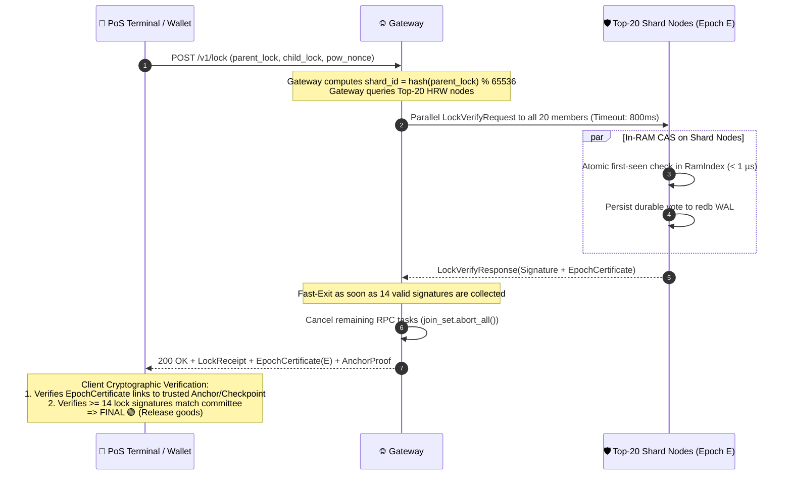
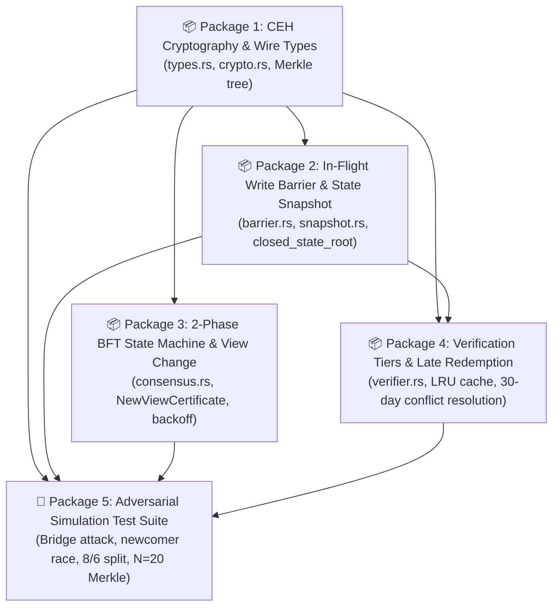

# HuMoCo Layer 2 – Certified Epoch Handoff Specification (CEH)
**Deterministic Committee Succession, BFT State Continuity & Verified Light-Client Checkpoints**

- **Document Version:** 1.5.0 (Post-Audit CP-0042 Hardening & Subagent Execution Architecture)
- **Status:** Architectural Specification & Formal Verification Baseline
- **Target Components:** `crates/humoco-node`, `crates/humoco-sim-core`
- **Applicable Specs:** Spec 01, Spec 07, Spec 11, Spec 12, Spec 14, Spec 15
- **Domain Invariant Authority:** `crates/humoco-sim-core/src/storage.rs:7` (`MAX_LOCK_TTL_YEARS = 11`)

---

## 1. Executive Summary & Design Rationale

### 1.1 The Vulnerability of Unconstrained Subjective Discovery
In the baseline design, nodes independently computed the 20-member committee for each shard ($S \in [0, 65535]$) via Rendezvous Hashing (HRW) over their locally discovered, mature F2F peers. This created an open vulnerability under network partitions and organic growth:
1. **Divergent Views (Split-Brain):** Two network partitions (or an organically grown network split by a single bridge) could each discover a distinct 20-member subset, each forming an apparently valid 14-member quorum for the same spend slot.
2. **Concurrent Activation Race:** Newcomers activating after local data copying without an old-write cutoff could join unnotified old members to sign an incompatible lock while an earlier 14-vote certificate was already released.

### 1.2 The Solution: Certified Epoch Handoff (CEH)
CEH replaces continuous, subjective rank recalculation with **discrete, cryptographically chained Epoch Committees**.
- A shard committee consists of exactly 20 distinct `NodePubKey` identities authorized for a fixed **Epoch** ($E$).
- Successor committees for Epoch $E+1$ are **not** self-proclaimed. They are explicitly authorized by a **14-of-20 BFT threshold signature from the predecessor committee** of Epoch $E$.
- The PoS checkout hot-path remains completely decoupled from consensus and state machine replication ($< 1\,\mu\text{s}$ in-RAM CAS, local node time $< 5\,\text{ms}$, end-to-end checkout latency $500\dots1500\,\text{ms}$).
- Committee transition is an infrequent, asynchronous background control-plane event executed via a deadlock-free 2-phase BFT round protocol with proposer fallback, unboundedly growing timeout backoff, and verifiable `NewViewCertificate` proofs.
- In-flight writes are cleanly drained via an atomic write barrier where committed decisions are never discarded (`active_in_flight_writes` barrier).
- State continuity across epoch boundaries resolves pre-quorum splits via **Late-Certificate Redemption** within a bounded 30-day window, ensuring that previously certified payments can always be redeemed on successors while unredeemed splits freeze permanently to guarantee double-spend prevention.
- **Radical Storage Optimization:** At $N = 20$, a single Unified Network Epoch Manifest with a 65,536-leaf Merkle root commits to all shards in $\approx 2.1\,\text{KB/day}$. For $N \ge 21$, standard HRW applies with a rolling 30-day certificate window, bounding per-node certificate storage realistically (e.g. $\approx 2.59\,\text{GB}$ at $N=41$, $\approx 106\,\text{MB}$ at $N=1,000$).

---

## 2. Core Invariants & Fault Model

1. **Quorum Size ($Q = 14 / 20$):** Every binding decision (payment lock attestation, state closure, and successor handoff) requires at least 14 valid, distinct signatures from the 20 authorized members of that epoch.
2. **Fault Bound ($f \le 6$):** Within any authorized 20-member committee, at most $f = 6$ members may be Byzantine (offline, malicious, equivocating, or silent).
3. **Quorum Intersection Property:**
   $$\forall Q_A, Q_B \subset C_E \text{ with } |Q_A| \ge 14, |Q_B| \ge 14, |C_E| = 20:$$
   $$|Q_A \cap Q_B| \ge 14 + 14 - 20 = 8$$
   With at most $f = 6$ Byzantine members, the intersection contains at least:
   $$|Q_A \cap Q_B \cap \text{Honest}| \ge 8 - 6 = 2 \text{ honest members}$$
4. **Durable Sign-Once Mandate (No Equivocation):** Honest nodes persist their signing decisions to non-volatile storage (`redb` WAL) *before* releasing signatures over the wire. An honest node never signs two divergent payloads for the same epoch round. Any detected dual signature constitutes irrefutable first-party fraud (`HUMOCO_V1_EQUIVOCATION`) resulting in immediate identity ban and WoT severance.
5. **Decoupled TTL Horizons (Vouchers vs. Certificates):**
   - **Voucher Lock Retention:** Collision locks remain stored in `redb` until the voucher root expires ($T_{\text{max}} = 11\,\text{years} + 30\,\text{s}$ per `crates/humoco-sim-core/src/storage.rs:7`).
   - **Certificate Sliding Window:** Shard nodes and gateways maintain a rolling **30-day verification window** of historical `EpochCertificate`s.
   - **Historical Evidence vs. Settled State:** Once a lock is certified and incorporated into a committed `closed_state_root` of Epoch $E+1$, it is an established invariant in canonical node storage. Verification of ancient settled locks queries the active storage state; it does not require an unbroken 11-year certificate chain.
   - **Late Conflict Redemption Window ($T_{\text{late}} = 30\,\text{days}$):** Pre-quorum splits marked `PROVISIONAL_CONFLICT` accept late 14-vote predecessor certificates for up to 30 days. After 30 days, unredeemed split slots become permanently blocked until voucher root expiry (`valid_until + 30s`).

---

## 3. Data Structures & Wire Formats

All wire encodings use safe, fixed-size standard types with length-prefixed BLAKE3 domain tags (`HUMOCO_V1_CEH_*`).

### 3.1 `GenesisManifest` (The Root Anchor)
Fixed once when the network reaches $N \ge 20$ mature nodes.
```rust
pub struct GenesisManifest {
    pub protocol_version: u32,
    pub network_id: [u8; 32],
    pub genesis_timestamp: u64,
    pub initial_committee: [NodePubKey; 20],
    pub genesis_signatures: Vec<(NodePubKey, Signature)>, // >= 14 valid
}
```

### 3.2 `EpochCertificate` (The Successor Link for Federated Shards)
Issued by the active committee to authorize the next committee.
```rust
pub struct EpochCertificate {
    pub shard_id: u16,
    pub epoch: u64,
    pub round: u32,
    pub predecessor_cert_hash: [u8; 32],
    pub closed_state_root: [u8; 32],
    pub successor_committee: [NodePubKey; 20],
    pub predecessor_signatures: Vec<(NodePubKey, Signature)>, // >= 14 from predecessor committee
}
```
**Exact Wire Size Analysis:**
- Header (shard_id, epoch, round, predecessor_hash, closed_state_root): $2 + 8 + 4 + 32 + 32 = 78\,\text{bytes}$.
- 20 NodePubKeys: $20 \times 32 = 640\,\text{bytes}$.
- Up to 20 Signatures with identity tags: $20 \times (32 + 64) = 1,920\,\text{bytes}$ ($\ge 14$ signatures = $1,344\,\text{bytes}$).
- **Total Certificate Wire Size:** $\approx 2.1\dots2.7\,\text{KB}$.

### 3.3 `UnifiedNetworkEpochManifest` (Pioneer Mode at $N=20$)
At $N=20$, all 65,536 shards share the identical 20-node pioneer committee. To prevent 65,536-fold duplication, a single unified manifest is issued daily committing to a 65,536-leaf BLAKE3 Merkle tree:
$$\text{leaf}_i = \text{BLAKE3}(\text{u16::to\_le\_bytes}(i) \parallel \text{closed\_state\_root}_i).$$
```rust
pub struct UnifiedNetworkEpochManifest {
    pub epoch: u64,
    pub round: u32,
    pub predecessor_manifest_hash: [u8; 32],
    pub shards_merkle_root: [u8; 32],
    pub pioneer_committee: [NodePubKey; 20],
    pub pioneer_signatures: Vec<(NodePubKey, Signature)>, // >= 14 from pioneer committee
}
```
**Wire Size:** $\approx 2.1\,\text{KB}$ total per day for the entire network ($N=20$).

### 3.4 `LockReceipt` (The PoS Checkout Evidence)
Presented to the merchant PoS terminal to prove irreversible finality.
```rust
pub struct LockReceipt {
    pub shard_id: u16,
    pub epoch: u64,
    pub parent_lock: [u8; 32],
    pub child_lock: [u8; 32],
    pub valid_until: u64,
    pub attestations: Vec<(NodePubKey, Signature)>, // >= 14 from current epoch committee
}
```

### 3.5 BFT Control-Plane Messages
```rust
pub struct EpochProposal {
    pub shard_id: u16,
    pub epoch: u64,
    pub round: u32,
    pub closed_state_root: [u8; 32],
    pub successor_committee: [NodePubKey; 20],
    pub candidate_proofs: Vec<CandidateProof>,
    pub prepared_proof: Option<PreparedProof>, // Present if locked from earlier round
}

pub struct PrepareVote {
    pub shard_id: u16,
    pub epoch: u64,
    pub round: u32,
    pub proposal_hash: [u8; 32],
    pub voter: NodePubKey,
    pub signature: Signature,
}

pub struct CommitVote {
    pub shard_id: u16,
    pub epoch: u64,
    pub round: u32,
    pub proposal_hash: [u8; 32],
    pub voter: NodePubKey,
    pub signature: Signature,
}

pub struct RoundChangeMessage {
    pub shard_id: u16,
    pub epoch: u64,
    pub failed_round: u32,
    pub next_round: u32,
    pub highest_prepared: Option<PreparedProof>,
    pub voter: NodePubKey,
    pub signature: Signature,
}

pub struct NewViewCertificate {
    pub shard_id: u16,
    pub epoch: u64,
    pub new_round: u32,
    pub round_change_messages: Vec<RoundChangeMessage>, // >= 14 valid
}
```

---

## 4. Protocol Lifecycle & Execution Workflows

### 4.1 Cold Bootstrap & Network Scaling Boundaries
1. **Community-Mesh Phase ($N < 20$):**
   - The network operates in `PROVISIONAL` mode 🟡.
   - All nodes validate all 65,536 shards with adaptive quorum $Q(N) = \lfloor \frac{2}{3} N \rfloor + 1$.
   - Payments carry provisional status.
2. **Transition to Pioneer Mode ($N = 20$):**
   - When the 20th mature F2F identity passes the 24-hour incubation wall, the 20 pioneer nodes construct `GenesisManifest(Epoch = 0)`.
   - At least 14 pioneer nodes sign the manifest. The hash of this manifest becomes the immutable `NetworkAnchor`.
   - While $N = 20$, the network operates in Unified Mode issuing `UnifiedNetworkEpochManifest` ($\approx 2.1\,\text{KB/day}$).
3. **Transition to Federated Sharding ($N \ge 21$):**
   - As soon as $N \ge 21$, standard HRW sharding applies strictly: each shard has its own deterministically computed 20-node committee.
   - Transitions occur per shard via individual `EpochCertificate`s.
   - No ad-hoc clustering or altered membership rules are introduced for $N \in [21, 40]$.

---

### 4.2 Checkout Hot-Path & Latency Budget

- **Local RAM CAS on Shard Nodes:** $< 1\,\mu\text{s}$.
- **Node Internal Processing SLA:** $< 5\,\text{ms}$ (in-RAM collision check + redb WAL write).
- **End-to-End PoS Checkout Latency:** $500\dots1500\,\text{ms}$ (parallel QUIC network RTTs with an 800 ms collection deadline).



#### Client Verification Tiers:
1. **Tier 1 (Zero-Trust Cryptographic Verification - Mandatory for FINAL):**
   - The Gateway returns the `LockReceipt` (with $\ge 14$ signatures) together with the active `EpochCertificate(E)` and missing intermediate certificates linking back to the terminal's trusted Anchor or recent Checkpoint.
   - The terminal cryptographically verifies:
     a) `EpochCertificate(E)` validly chains to the trusted Checkpoint/Anchor.
     b) At least 14 signatures on `LockReceipt` belong to the 20 members authorized in `EpochCertificate(E)`.
   - The terminal caches verified certificates in an **in-RAM LRU cache** ($\approx 1.35\,\text{MB}$ for 500 daily checkouts across distinct shards). Zero persistent disk footprint for foreign shards!
2. **Tier 2 (Statistical HRW Sanity Check):**
   - As an immediate local heuristic, the terminal calculates deterministic HRW ranks on its known-node catalog:
     $\text{Score} = \text{BLAKE3}(\text{HrwRoutingId} \parallel \text{shard\_id})$.
   - Checks whether the signers are plausible high-ranking members. This detects eclipse attempts early, but does not substitute for the cryptographic certificate chain.
3. **Tier 3 (Trusted Gateway / In-Store Node):**
   - For merchants running their own node on LAN (`localhost:8080`), the local node performs complete CEH chain verification, and the terminal accepts the gateway's verified `FINAL` receipt directly.

---

### 4.3 The Transition Protocol: Deadlock-Free BFT Handoff (CP-0042 Hardened)

```mermaid
sequenceDiagram
    autonumber
    participant P as 👑 Round Proposer (Rank r % 20)
    participant C as 👥 Current Committee Members (20 Nodes)
    participant S as 🌟 Successor Committee (20 Nodes)

    Note over C: Trigger: Routine window when candidate ranks shift
    C->>C: Stage 1: FENCE_DRAIN (Reject new ingress with 503; await in-flight task drain)
    C->>C: Stage 2: FENCE_LOCKED (Sync WAL flush; freeze closed_state_root)
    
    Note over P: Round r starts (Timeout: T_r = T_0 * 2^r, unbounded)
    P->>C: Phase 1: PROPOSE(Epoch E+1, Round r, CandidatePool, closed_state_root, Proofs)
    
    loop Phase 1 Validation (Prepare)
        C->>C: Check Lock-on-Prepared: If locked on earlier value V, proposal must carry V
        C->>C: Check Candidate Proofs & State Completeness
        C->>C: Persist PREPARE to redb WAL
    end
    C-->>P: PREPARE(Signature)
    
    Note over P: 14 Prepares collected -> PREPARED CERTIFICATE formed
    P->>C: Phase 2: COMMIT(Epoch E+1, Round r, PreparedProof)
    
    loop Phase 2 Validation (Commit)
        C->>C: PUBLIC VALIDITY: PreparedProof with 14 Prepares forces Commit!
        C->>C: Retain any private uncertified choices locally in redb
        C->>C: Persist COMMIT to redb WAL
    end
    C-->>P: COMMIT(Signature)
    
    Note over P: 14 Commits collected -> EpochCertificate(E+1) complete!
    P->>S: Deliver EpochCertificate(E+1) + Verified Active Locks
    S->>S: Install active locks into redb WAL and RamIndex
    Note over S: Epoch E+1 is now ACTIVE!
```

#### Detailed Protocol Rules:

1. **True In-Flight Write Barrier (No Revocation of Committed Choices):**
   - Every committee node tracks in-flight write operations: `active_in_flight_writes: AtomicU32`.
   - **Stage 1 (`FENCE_DRAIN`):** When the handoff maintenance window opens, new ingress requests are rejected with `HTTP 503 Service Unavailable` and header `Retry-After: 2`. The node awaits:
     $$\text{active\_in\_flight\_writes} == 0$$
   - **No Revocation of Signed Choices:** If an in-flight operation has already persisted a vote to `redb` or emitted a signature over the wire, it is **never cancelled or revoked**. It completes fully and is included in the active lock set. The counter decrements only when the task completely finishes its storage interaction. If a socket times out at the gateway, the server-side vote remains binding.
   - **Stage 2 (`FENCE_LOCKED`):** With `active_in_flight_writes == 0`, a synchronous `redb` disk flush freezes the active lock set. `closed_state_root` is computed. No write can race the snapshot.

2. **Self-Contained Candidate Pool & Objective Selection:**
   - The proposer provides full cryptographic proof bundles for all 20 candidates:
     `CandidateProof = (NodePubKey, Argon2dTicket, Timestamp, F2FSignature)`.
   - Members verify:
     a) All 20 candidate tickets are cryptographically valid, mature ($> 24\,\text{h}$), and non-banned.
     b) Candidates are sorted deterministically by $\text{BLAKE3}(\text{HrwRoutingId} \parallel \text{Shard\_ID})$.
     c) Objective inclusion: Candidates match the active catalog. Honest members reject a proposal if and only if an authenticated proof of an omitted higher-ranking candidate from the previous catalog is proven.

3. **Public Validity vs. Private Retention & Late-Certificate Redemption:**
   - *Public Validity:* A proposal carrying an authentic `PreparedProof` (14 valid Prepares) is publicly valid. In Round $r+1$, all honest members commit $P$, overriding subjective omission objections.
   - *Pre-Quorum Conflict Handling & Late-Certificate Redemption:*
     a) **Confirmed Locks:** Any lock with 14 votes intersects any 14-member prepare set in $\ge 2$ honest nodes; it is guaranteed to be in `closed_state_root`.
     b) **Divergent Pre-Quorum Splits:** If old nodes split votes (e.g., 8 honest signed $A$, 6 honest signed $B$, neither reaching 14 in the old nodes' view), the successor committee marks the slot as `PROVISIONAL_CONFLICT`.
     c) **Late-Certificate Redemption ($T_{\text{late}} = 30\,\text{days}$):** If a client, merchant, or gateway presents a valid 14-vote `LockReceipt` for $A$ signed by the authorized predecessor committee within 30 days, the successor committee **must accept and redeem $A$, clearing the conflict in favor of $A$**!
     d) If no 14-vote certificate is presented within 30 days, both branches remain blocked until voucher expiry (`valid_until + 30s`), permanently preventing double spends.

4. **Verifiable View-Change & Unbounded Timeout Backoff:**
   - If a round fails to assemble 14 Prepares or 14 Commits within the timeout, members broadcast:
     `ROUND_CHANGE(Round r+1, HighestPreparedProof, Signature)`.
   - Timeout scales exponentially without artificial cap: $T(r) = T_0 \times 2^r$ ($T_0 = 2\,\text{s}$). Under partial synchrony after GST, progress is mathematically guaranteed.
   - **`NewViewCertificate` Mandate:** The new proposer for Round $r+1$ gathers 14 valid `ROUND_CHANGE` messages into a `NewViewCertificate`. Members independently verify that the proposed value matches the highest prepared proof in the certificate before preparing.

5. **Crash-Safe Persistence:**
   `FENCE_LOCKED`, `PREPARE` votes, `COMMIT` votes, and successor state installation are synchronously flushed to `redb` WAL before any network message is transmitted.

---

## 5. Security & Robustness Proof Sketches

### Theorem 1: Freedom from Conflicting Certificates (Split-Brain Impossibility)
*Claim:* In any given Epoch $E$, it is impossible for two conflicting payment locks $L_A$ and $L_B$ (or two conflicting successor certificates $C_{E+1}^A$ and $C_{E+1}^B$) to both obtain 14 valid signatures.

*Proof:*
1. Let the authorized committee for Epoch $E$ be $C_E$ with $|C_E| = 20$.
2. Suppose for contradiction that both $L_A$ and $L_B$ achieve 14 distinct valid signatures from $C_E$. Let these signer sets be $Q_A$ and $Q_B$, with $|Q_A| \ge 14$ and $|Q_B| \ge 14$.
3. By the Pigeonhole Principle, the intersection must contain:
   $$|Q_A \cap Q_B| \ge |Q_A| + |Q_B| - |C_E| = 14 + 14 - 20 = 8 \text{ identities}.$$
4. By the fault model, at most $f = 6$ identities in $C_E$ are Byzantine.
5. Therefore, the intersection contains at least $8 - 6 = 2$ honest identities.
6. An honest identity adheres to the Durable Sign-Once rule: it never signs conflicting locks for the same slot.
7. Thus, at least 2 honest identities must have refused to sign the second lock.
8. Contradiction. Hence, two conflicting certificates cannot both reach 14 signatures. $\blacksquare$

---

### Theorem 2: Deadlock-Free Transition under Partial Synchrony & Fault Bound ($f \le 6$)
*Claim:* If up to $f = 6$ committee members are Byzantine, silent, or propose conflicting values, the committee guarantees progress and commits exactly one successor `EpochCertificate(E+1)` after GST.

*Proof:*
1. There are 20 members, of which at least $20 - 6 = 14$ are honest and connected after GST with maximum delay $\Delta < \infty$.
2. If a Byzantine proposer splits votes across different values, no value can gather 14 Prepares.
3. After round timeout $T(r) = T_0 \times 2^r$, the 14 honest members broadcast signed `ROUND_CHANGE` messages.
4. Because $T(r)$ grows unboundedly, there exists a round $r^*$ where $T(r^*) > 2\Delta$, eliminating premature timeouts.
5. Within at most $f+1 \le 7$ rounds, an honest proposer is reached. The honest proposer gathers 14 `ROUND_CHANGE` messages, constructs a valid `NewViewCertificate`, and broadcasts the proposal.
6. If an earlier value $P$ reached 14 Prepares, it is bound by the `NewViewCertificate`. By the Public Validity rule, all 14 honest members commit $P$, regardless of private omission objections.
7. If no prior value reached 14 Prepares, the honest proposer incorporates all active obligations, and all 14 honest members prepare and commit the value.
8. The 14 honest members commit the prepared value, assembling the required 14 signatures for `EpochCertificate(E+1)`. $\blacksquare$

---

### Theorem 3: Resilience under Physical Network Partitions
*Claim:* If the network partitions into arbitrary disconnected subgraphs, no partition can generate an unauthorized certificate.

*Proof:*
1. Let the 20 committee members be partitioned into disconnected components $P_1, P_2, \dots, P_k$.
2. Since $\sum |P_i| = 20$, at most one component can satisfy $|P_m| \ge 14$ (since $14 \times 2 = 28 > 20$).
3. If no component contains $\ge 14$ members, all components halt write progress safely. No payments and no committee handoffs can be certified.
4. If one component contains $\ge 14$ members, that component alone can continue operating. All other components safely reject writes due to lack of quorum.
5. In no case can two partitions simultaneously certify conflicting state. $\blacksquare$

---

## 6. Zero State Bloat & Honest Storage Accounting

| Network Size ($N$) | Mean Shards / Node ($\frac{20}{N} \times 65,536$) | 30-Day Certificate Storage / Node | Storage Mode |
| :---: | :---: | :---: | :---: |
| **$N = 20$** | 65,536 (All Shards) | **$\approx 63\,\text{KB}$** | Unified Network Epoch Manifest ($\approx 2.1\,\text{KB/day}$) |
| **$N = 41$** | $\approx 31,968$ | **$\approx 2.59\,\text{GB}$** | Federated HRW Sharding ($2.7\,\text{KB} \times 30\,\text{days}$) |
| **$N = 100$** | $\approx 13,107$ | **$\approx 1.06\,\text{GB}$** | Federated HRW Sharding ($2.7\,\text{KB} \times 30\,\text{days}$) |
| **$N = 1,000$** | $\approx 1,310$ | **$\approx 106\,\text{MB}$** | Federated HRW Sharding ($2.7\,\text{KB} \times 30\,\text{days}$) |
| **$N = 10,000$** | $\approx 131$ | **$\approx 10.6\,\text{MB}$** | Federated HRW Sharding ($2.7\,\text{KB} \times 30\,\text{days}$) |
| **Worst-case single node** | 65,536 (All Shards) | **$\approx 5.3\,\text{GB}$** | Retaining all shards for 30 days |

*Note:* Storage figures cover rolling 30-day certificate history only. Active collision locks are persisted in `redb` until voucher root expiry ($T_{\text{max}} = 11\,\text{years} + 30\,\text{s}$) with fixed 144-byte binary footprint per lock.

---

## 7. Subagent Implementation Architecture & Work Packages

To execute the implementation cleanly without merge collisions or context exhaustion, the implementation is partitioned into **five independent, contract-bounded work packages**:



### 7.1 Package 1: CEH Cryptography, Types & Merkle Tree
- **Scope:** `crates/humoco-sim-core/src/ceh/types.rs`, `crates/humoco-sim-core/src/ceh/crypto.rs`
- **Deliverables:**
  1. Rust structs: `GenesisManifest`, `EpochCertificate`, `UnifiedNetworkEpochManifest`, `LockReceipt`, `EpochProposal`, `PrepareVote`, `CommitVote`, `RoundChangeMessage`, `NewViewCertificate`.
  2. Length-prefixed BLAKE3 domain separation (`HUMOCO_V1_CEH_*`).
  3. BLAKE3 Merkle Tree computation for 65,536 shard roots in `UnifiedNetworkEpochManifest`.
  4. Safe binary serialization/deserialization without `unsafe`.
  5. Unit tests verifying canonical encoding and deterministic hashing.

### 7.2 Package 2: In-Flight Write Barrier & State Snapshot
- **Scope:** `crates/humoco-sim-core/src/ceh/barrier.rs`, `crates/humoco-sim-core/src/ceh/snapshot.rs`
- **Deliverables:**
  1. `AtomicU32` in-flight write tracker with two-stage barrier (`FENCE_DRAIN` $\to$ `FENCE_LOCKED`).
  2. Guaranteed non-revocation: in-flight operations with durable disk writes complete fully before `FENCE_LOCKED`.
  3. Snapshot builder: computes set union of active, unexpired locks and deterministically calculates `closed_state_root`.
  4. Unit tests verifying race-free drain under simulated concurrent ingress.

### 7.3 Package 3: 2-Phase BFT State Machine & View Change
- **Scope:** `crates/humoco-sim-core/src/ceh/consensus.rs`
- **Deliverables:**
  1. Discrete-event BFT transition state machine (Propose $\to$ Prepare $\to$ Commit).
  2. Public Prepared Validity: 14 Prepares force Commit in Round $r+1$.
  3. Lock-on-Prepared: prevents equivocation across rounds.
  4. View-change protocol with `RoundChangeMessage`, `NewViewCertificate`, and unbounded exponential backoff ($T_0 \times 2^r$).
  5. Deterministic proposer selection: $\text{proposer}(r) = r \pmod{20}$.
  6. Unit tests proving liveness under $f \le 6$ silent/byzantine nodes.

### 7.4 Package 4: Verification Tiers, LRU Cache & Late-Certificate Redemption
- **Scope:** `crates/humoco-sim-core/src/ceh/verifier.rs`
- **Deliverables:**
  1. Tier-1 cryptographic chain verifier linking `EpochCertificate(E)` back to `GenesisManifest` or trusted checkpoint.
  2. In-RAM LRU cache for PoS terminals ($\approx 1.35\,\text{MB}$ for 500 shards).
  3. Late-Certificate Redemption: evaluates 14-vote predecessor receipt presented within $T_{\text{late}} = 30\,\text{days}$ to resolve `PROVISIONAL_CONFLICT`.
  4. Permanent block after 30 days for unresolved splits.

### 7.5 Package 5: Adversarial Simulation Test Suite
- **Scope:** `crates/humoco-sim-core/tests/ceh_adversarial_suite.rs`
- **Deliverables:**
  1. **Test 1 (39-Node Bridge Attack):** Reproduces two partitions separated by a bridge; proves conflicting 14-vote certificates are rejected.
  2. **Test 2 (22-Node Newcomer Activation Race):** Proves write-fencing and state transfer prevent conflicting lock issuance during node turnover.
  3. **Test 3 (8/6 Split + View Change):** Proves progress and late-certificate resolution under 8 honest + 6 Byzantine nodes.
  4. **Test 4 (Unified Manifest at $N=20$):** Proves Merkle-root verification covers all 65,536 shards in a single $2.1\,\text{KB}$ payload.
