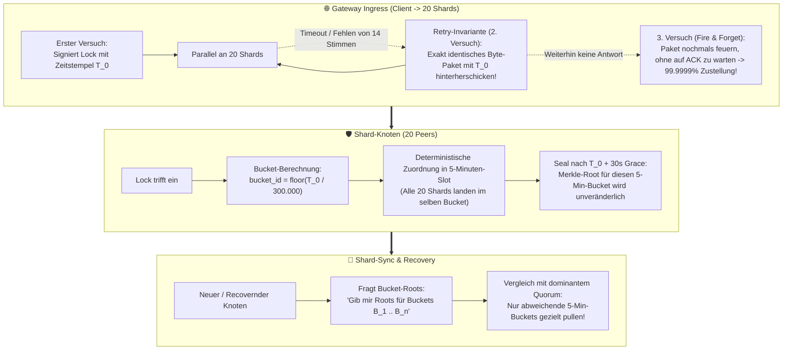

# 📐 Architektur-Plan: 5-Minuten Bucketed Shard-Digest, Deterministischer Pull-Sync & Gateway-Retry-Invariante

> **Status:** Entwurf / Planung (noch nicht ausgeführt)  
> **Ziel:** Skalierbarer, deterministischer Shard-Abgleich unter Hochlast ($> 1.000\,\text{Tx/s}$) ohne Datenmüll, ohne Vollabgleiche und mit strikter Idempotenz.

---

## 🏛️ 1. Kern-Problemstellung (Ist-Zustand vs. Soll-Zustand)

### Ist-Zustand im aktuellen Code:
1. **Globaler monolithischer Digest (`compute_shard_digest_at` in `crypto.rs:346`):**
   * Alle aktiven Locks eines Shards werden in einen einzigen BLAKE3-Hash gehasht.
   * Wenn 2 Knoten divergieren, weiß niemand, **welche** Locks fehlen.
2. **Brute-Force Vollabgleich (`daemon.rs:1175`):**
   * Bei Divergenz lädt der Knoten seitenweise (500er-Chunks) den gesamten Shard-Bestand über `ActiveSyncRequest` herunter.
   * Bei hoher Last kommen während des Downloads ständig neue Locks hinzu $\to$ der globale Hash passt nie zusammen (Livelock).
3. **Mögliche Timestamp-Fragilität bei Gateway-Retries:**
   * Wenn ein Gateway bei Quorum-Timeouts ein Paket mit neuem Zeitstempel schnüren würde, landeten Retries auf unterschiedlichen Shard-Knoten in unterschiedlichen Zeitfenstern $\to$ Shard-Split-Brain.

---

## 🧱 2. Die 4 Säulen der Lösung

---

## 📋 3. Detaillierter Umsetzungsplan

### Phase 1: Gateway Ingress, Retry-Invariante & Triple-Send Heuristik
* **Verankerung der Gateway-Invariante in `crates/humoco-node/src/api/routes.rs`:**
  * Wenn `assemble_quorum_certificate` oder `collect_peer_attestations` ein Timeout erleidet oder zusätzliche Retries nötig sind, wird das `wire_payload` **einmalig** vor dem ersten Sendeversuch serialisiert und signiert (`LockWirePayload::Hmc`).
  * **Strikte Invariante:** Bei erneuten Sendeversuchen (Retries) an säumige Shard-Peers wird **stets das bitgenau identische Byte-Paket mit dem ursprünglichen `timestamp_ms`, `epoch_seq` und der ursprünglichen `sender_signature` wiederverwendet.**
  * Ein Neu-Generieren von Zeitstempeln (`now_ms`) für Retries desselben Locks ist streng verboten (Schutz vor Bucket-Fragmentierung und Double-Signing-Verdacht).
* **Fire-and-Forget 3-Send Heuristik (Präventive Paketverlust-Reduktion):**
  * Bleibt ein Shard-Knoten beim ersten Versuch stumm, sendet das Gateway einen 2. Versuch (Retry mit Timeout).
  * Bleibt der Knoten auch beim 2. Versuch ohne Antwort, feuert das Gateway noch einen **3. Versuch als asynchronen Fire-and-Forget-Versuch** hinterher (ohne auf die Antwort zu warten oder den Checkout zu blockieren).
  * **Stochastischer Effekt:** Bei üblichem UDP-Paketverlust von ca. $1\,\%$ ($p = 0{,}01$) sinkt die Wahrscheinlichkeit, dass ein gesunder, laufender Shard-Knoten den Lock verpasst, von $1\,\%$ auf $0{,}01^3 = 0{,}000001 = 0{,}0001\,\%$ (1 zu einer Million!).
  * **Nutzen:** Dadurch sind 99,9999 % aller aktiven Shard-Knoten von vornherein synchron, und der spätere Pull-Sync muss im Normalbetrieb fast gar nichts mehr nachkorrigieren.

### Phase 2: 5-Minuten Buckets & Slot-Ring im RAM (Zero Storage Overhead)
* **Mathematische Slot-Berechnung ($O(1)$ ohne extra Datenbankspalte):**
  $$\text{bucket\_id} = \lfloor \frac{\text{timestamp\_ms}}{300.000} \rfloor$$
  * Für den historischen Anker: Genesis-Locks setzen `voucher_roots[voucher_id] = valid_until`.
  * Für Live-Locks: Der im Paket signierte Gateway-Zeitstempel bestimmt den 5-Minuten-Slot.
* **Rotierender 24h-Slot-Ring im RAM (`crates/humoco-sim-core` & `humoco-node`):**
  * Pro Shard wird ein Array aus $288$ Slots vorgehalten ($24\,\text{Stunden} \times 12\,\text{Buckets/Stunde}$).
  * Pro Slot:
    * `bucket_id: u64`
    * `merkle_root: [u8; 32]` (berechnet aus allen Locks dieses Slots, sortiert nach `parent_lock` / `lock_id`)
    * `is_sealed: bool` (wird versiegelt, sobald $\text{current\_time} > (\text{bucket\_id} + 1) \times 300.000 + 30.000\,\text{ms}$)
  * **Speicheraufwand:** $288 \times 40\,\text{Bytes} \approx 11{,}5\,\text{KiB}$ RAM pro Shard. Absolut vernachlässigbar!

### Phase 3: Protokoll-Erweiterung für Bucketed Pull-Sync (`wire.rs` & `transport.rs`)
* **Erweiterung von `ShardDigestRequest` / `Response`:**
  * `ShardDigestRequest`:
    * Enthält neu: `shard_id: u16`, `start_bucket: u64`, `bucket_count: u16` (z. B. letzte 12 Buckets = 1 Stunde).
  * `ShardDigestResponse`:
    * Liefert die Liste von `(bucket_id, merkle_root, lock_count)`.
    * Für 1 Stunde Datenverkehr: $12 \times (8 + 32 + 4) = 528\,\text{Bytes}$ Wire-Größe!
* **Gezielter Bucket-Pull (`ActiveSyncRequest`):**
  * `ActiveSyncRequest`:
    * Enthält neu: `shard_id: u16`, `target_bucket_id: Option<u64>`, `cursor: u64`, `limit: usize`.
  * Erkennt ein Shard-Knoten beim Vergleich der Quorum-Digests, dass nur Bucket #42 abweicht:
    * Er fordert **ausschließlich** die Locks aus Bucket #42 an!
    * Alle anderen 287 Buckets der letzten 24 Stunden müssen **nicht** übertragen werden.

### Phase 4: Cold-Start & Langzeit-Löschung (Integration mit redb)
* **Kompakte Speicherung in `redb`:**
  * Nutzung des B-Tree-Prefixes `(bucket_id, lock_id)` oder Nutzung des bestehenden `TABLE_HMC_TTL_INDEX`.
  * Abrufen eines ganzen 5-Minuten-Buckets ist ein einzelner, sequenzieller Range-Scan auf der SSD (extrem schnell).
* **Automatisches TTL-Pruning:**
  * Wenn ein Gutschein abläuft (`valid_until` erreicht), löscht der bestehende Pruning-Ticker (`engine.rs`) die Locks physisch.
  * Ältere Slots ($> 24\,\text{Stunden}$) fallen automatisch aus dem schnellen 288-Slot-RAM-Puffer heraus und bilden den stabilen Archiv-Bestand.

---

## 🔒 5. Garantierte Invarianten

1. **Deterministischer Konsens:** Da alle Gateways für denselben Lock denselben Zeitstempel verwenden (auch bei Retries), landen die Daten auf allen 20 Shard-Knoten im exakt identischen 5-Minuten-Bucket.
2. **Livelock-Freiheit:** Da Buckets nach Ablauf des 30-Sekunden-Fensters versiegelt werden (`sealed`), ändert sich ihr Hash nicht mehr durch nachfolgenden Live-Traffic. Syncs auf versiegelten Buckets konvergieren garantiert.
3. **Zero State Bloat:** Keine zusätzlichen Metadaten-Spalten pro Lock in der Datenbank. Alles basiert auf der deterministischen Funktion des signierten Zeitstempels.
