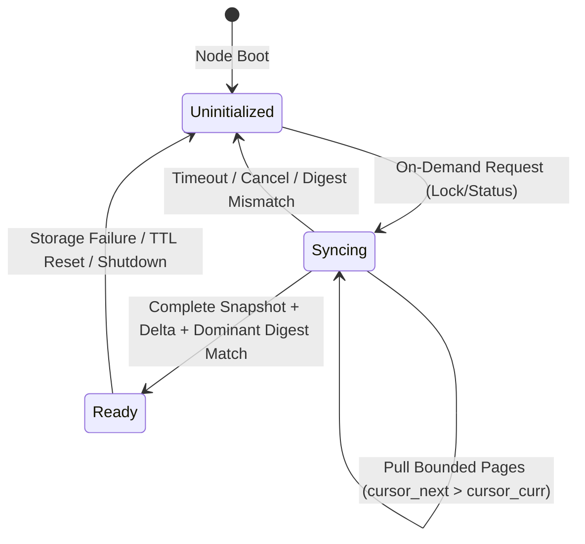

# Safety and Progress Prerequisites — Contracts G1–G5

**Document Status:** Canonical Safety & Progress Specification (Phase 7 / R3)  
**Date:** 2026-10-20  
**References:** DEC-053–DEC-065, DEC-080–DEC-087, `docs/ARCHITECTURE_CONSOLIDATION.md`, `docs/INVARIANT_REGISTRY.md`

---

## Executive Summary & Guiding Doctrine

> *"In decentralization there is no trust, only mathematical proofs."*  
> *"Subtraction before Construction – Perfection is achieved when there is nothing left to remove."*

This specification defines the five immutable safety and progress prerequisite contracts (**G1–G5**) for the HuMoCo Layer 2 Collision Lock Registry:
- **G1 (Current Authority):** Independent recipient justification of committee authority, network domain, and roster eligibility under bounded Byzantine faults ($f \le 6$ out of $N \ge 20$).
- **G2 (State Completeness & Safe Activation):** Verified on-demand shard recovery, monotonic bounded snapshot/delta streaming, and atomic activation without gaps or historical quorum archives.
- **G3 (Support & Merge Composition):** Class-first conflict resolution ($\text{Class 2} > \text{Class 1} > \text{Class 0}$), deterministic tie-breaking via $\min(H_{\text{canon}})$, protected original-choice durability (DEC-029), and strict first-party equivocation boundaries.
- **G4 (Time, Slots & Reentry):** Decentralized median time consensus, entry-only wallet freshness, bounded root TTL pruning, ticket incubation, and passive presence recovery.
- **G5 (Actual Storage Loss & Identity Safety):** Differentiation between ordinary intact process crashes (zero penalty) and catastrophic rollback/key-duplication (fail-closed halt, permanent operator alert).

---

## Contract G1: Justified Current Authority (S1 / S2)

### 1.1 Premise & Problem Statement
In a living, subjective peer-to-peer mesh, individual nodes maintain subjective views of active peers. A gateway cannot simply supply a self-selected roster of public keys to a client terminal and claim that these nodes constitute the consensus authority. A client or recipient must independently justify that a given 14-of-20 quorum represents the authentic authority for a given shard.

### 1.2 Explicit Assumptions
1. **Byzantine Fault Bound:** In any regional committee of $N = 20$ nodes, at most $f \le 6$ nodes may be Byzantine (corrupted, colluding, or offline). The BFT threshold is fixed at $Q = 14$ ($14 > \frac{2}{3} \times 20$).
2. **Work-Backed Identity (Argon2d):** Every eligible node is anchored by an immutable Ed25519 `NodePubKey` and an Argon2d `HrwRoutingId` satisfying `HrwRoutingId = Argon2d(NodePubKey || Nonce || T0)`.
3. **24-Hour Incubation Wall:** A shard ticket is only eligible for committee selection after a maturation period of 24 hours ($t_{\text{now}} - t_{\text{first\_seen}} \ge 86,400\,\text{s}$). Opportunistic ticket grinding is physically eliminated.
4. **Passive Presence (Dunbar Fan-out):** A node is active if it has been observed within the last 3 hours ($\le 2$ missed hourly heartbeat slots). Nodes missing $\ge 3$ consecutive hourly heartbeats are marked suspended.

### 1.3 Authenticated Inputs & Retained Fields
* `network_id`: 32-byte canonical network domain separator (prevents cross-network replay).
* `shard_id`: 16-bit integer derived strictly from the consumed output: $\text{Shard}(O) = \text{u16::from\_be\_bytes}([O_0, O_1])$ (Big-Endian prefix of parent output bytes; wire/digest scalar serialization uses `.to_le_bytes()`).
* `recipient_challenge`: 32-byte cryptographically secure random nonce generated by the receiving merchant/terminal for a specific checkout instance.
* `committee`: Ordered list of up to 20 distinct `NodePubKey` identities computed via HRW:
  $$\text{Score}(P_i, S) = \text{BLAKE3}(\text{HrwRoutingId}(P_i) \mathbin{\Vert} S)$$
  sorted descending by full 256-bit score with deterministic public key tie-breaking.
* `signatures`: Exactly 14 distinct valid Ed25519 signatures from members of the top-20 committee over the canonical attestation digest.

### 1.4 Verifier Rules & Enforceable Invariants
1. **Roster Justification:** The recipient recomputes or validates the HRW ranking against its known set of mature, active nodes. An arbitrary gateway-supplied list of keys is rejected unless each key is a verified, mature, non-suspended member of the calculated top-20 committee.
2. **No Rank 21–40 Substitution:** If any of the top-20 members are unreachable, cancelled, or return `FLAG_NOT_READY`, ranks 21..40 MUST NEVER be substituted. Quorum must be achieved strictly within the top-20 members ($14/20$).
3. **Quorum Intersection Guarantee:** For any two legitimate quorums $Q_1, Q_2 \subseteq \text{Top20}$ with $|Q_1| = 14$ and $|Q_2| = 14$:
   $$|Q_1 \cap Q_2| \ge 14 + 14 - 20 = 8$$
   Since $f \le 6$, at least $8 - 6 = 2$ honest nodes are present in the intersection. Two conflicting Class 2 receipts for the same output cannot be simultaneously approved.

### 1.5 Counterexamples Excluded
* *Counterexample 1.1 (Sybil Committee Takeover):* Adversary spins up 1,000 ephemeral nodes.  
  *Mitigation:* All ephemeral nodes lack mature 24h Argon2d tickets and F2F friendship edges; excluded from HRW selection.
* *Counterexample 1.2 (Gateway Roster Fabrication):* Malicious gateway invents 14 fake keys that sign an attestation.  
  *Mitigation:* Recipient verifier verifies each public key against independent F2F mesh directory or its own active peer table. Unrecognized or immature keys are hard-rejected.
* *Counterexample 1.3 (Replay of Stale Attestation):* Adversary replays a valid 14/20 certificate from an earlier purchase.  
  *Mitigation:* Recipient challenge is unique per checkout. Attestation digest length-prefixed domain tags strictly bind `recipient_challenge`. Replay fails signature verification.

---

## Contract G2: State Completeness & Safe Activation (S3 / S4)

### 2.1 Premise & Problem Statement
A newly started node, or a node newly assigned to a shard due to topology drift, initially possesses no verified state for that shard. It must default to `NOT_READY`. It can only publish `READY` and participate in signing when its state is provably complete, free of gaps, and aligned with dominant quorum consensus.

### 2.2 Explicit Assumptions
1. **Zero State Bloat:** Locks are retained strictly through `root.valid_until + 30s` (grace period). Expired locks are purged; historical quorum certificates are never hoarded or required.
2. **Deterministic Shard Digest:** Shard state digest $D(S, T)$ is an incremental BLAKE3 Merkle root or XOR-digest over all active, non-expired locks in shard $S$ valid at time $T$.
3. **Dominant Quorum Source:** State is retrieved exclusively from peers belonging to the verified top-20 committee for shard $S$.

### 2.3 Protocol & State Transitions

1. **Demand-Only Trigger:** No eager 65,536-shard background sweep. Shard sync is initiated on-demand upon first ingress request for shard $S$.
2. **Concurrency Bounds:** At most 1 sync job per shard; at most 32 concurrent sync jobs across the node daemon.
3. **Monotonic Streaming:** Pages are requested using monotonic cursors ($cursor_{i+1} > cursor_i$). Maximum page limit: 500 records; maximum page size: 1 MiB.
4. **Concurrent Write Handling:** Any write arriving during active synchronization is either queued in memory or rejected with `FLAG_NOT_READY`. It is NEVER acknowledged as durable until synchronization commits.
5. **Atomic Durable Commit:** Transferred records are written and synchronized to `redb` in atomic batches.
6. **Final Digest Verification:** Before transitioning from `Syncing` to `Ready`, the node computes its local shard digest $D_{\text{local}}(S)$ and verifies:
   $$D_{\text{local}}(S) == D_{\text{dominant}}(S)$$
   where $D_{\text{dominant}}(S)$ is attested by $\ge 14$ committee members.

### 2.4 Counterexamples Excluded
* *Counterexample 2.1 (Empty Source Trap):* Node connects to 1 peer that has an empty database; node marks shard ready.  
  *Mitigation:* A single peer or minority cannot supply dominant digest. Quorum requirement $\ge 14$ must acknowledge the digest before sync is considered convergent.
* *Counterexample 2.2 (Concurrent Write Gap):* A lock arrives via RPC while the snapshot page stream is midway.  
  *Mitigation:* Shard remains in `Syncing` (flags include `FLAG_NOT_READY`). The incoming write is not signed until local commit succeeds and post-sync digest matches.
* *Counterexample 2.3 (Full Committee Turnover):* All original signers of an existing lock have retired or gone offline.  
  *Mitigation:* Under DEC-083 (LRC-002), current qualified nodes attest the objective active state (`parent_lock`, `receiver_pub`, `nonce`, `id`). Historical signature archives are not required; current live nodes verify the cryptographic integrity of the lock and attest it with their own keys.

---

## Contract G3: Support & Merge Composition (S5)

### 3.1 Premise & Problem Statement
Network partitions ("island meshes") may operate independently and later rejoin ("Village Merge"). Conflicts must resolve deterministically, preserving confirmed states over unconfirmed states and preventing malicious or inadvertent equivocation framing.

### 3.2 Confirmation Class Precedence
Every lock receipt belongs to an immutable confirmation class:
1. **Class 2 (`RegionalConfirmed` / `FINAL`):** Attested by a full BFT quorum of 14-of-20 distinct members in a mature network ($N \ge 20$).
2. **Class 1 (`Provisional`):** Attested by an adaptive provisional quorum $Q(N) = \lfloor \frac{2}{3} N \rfloor + 1$ in an island mesh ($N < 20$).
3. **Class 0 (`Unconfirmed` / `Single-Node`):** Local unconfirmed write, pending propagation.

### 3.3 Merge Resolution Algorithm
Given two competing conflicting locks $L_A$ and $L_B$ for the same parent lock:
$$\text{Class}(L_A) > \text{Class}(L_B) \implies L_A \text{ wins, } L_B \text{ is VOID}$$
$$\text{Class}(L_B) > \text{Class}(L_A) \implies L_B \text{ wins, } L_A \text{ is VOID}$$
$$\text{Class}(L_A) == \text{Class}(L_B) \implies \begin{cases} L_A \text{ wins} & \text{if } H_{\text{canon}}(L_A) < H_{\text{canon}}(L_B) \\ L_B \text{ wins} & \text{if } H_{\text{canon}}(L_B) < H_{\text{canon}}(L_A) \end{cases}$$

### 3.4 Protected Original-Choice Slot (DEC-029 / DEC-087)
* When a node first observes a lock request in an isolated partition, it performs an atomic RAM CAS check and immediately executes an atomic durable `redb` commit of its original decision before releasing any vote.
* If a merge subsequently reveals a Class 2 winner with a lower hash, the node updates its canonical index to the winning branch.
* **Non-Equivocation Principle:** The losing local original vote does NOT constitute equivocation. The node voted honestly under the rules of its then-isolated partition. Sashing only applies to demonstrable first-party fraud.

### 3.5 First-Party Evidence Doctrine (Spec 10)
An equivocation proof `HUMOCO_V1_EQUIVOCATION` is valid IF AND ONLY IF:
1. It contains two distinct signed envelopes $E_1, E_2$ issued by the *same* `NodePubKey`.
2. Both envelopes reference the *same* slot (`parent_lock` / `output`).
3. Both envelopes commit to *conflicting* spent targets ($L_A \ne L_B$).
4. Both envelopes share the *same* purpose and network domain.
5. Both signatures verify against the node's public key.
*Hearsay, third-party reports, or telemetry metrics are inadmissible and cannot cause a ban.*

---

## Contract G4: Time, Slots & Reentry

### 4.1 Decentralized Median Time ($T_{\text{net}}$)
* Nodes maintain peer clock offsets derived from periodic heartbeat exchanges with direct F2F friends.
* $T_{\text{net}}$ is the median of local time and trusted neighbor timestamps.
* **Anti-Jump Guard (INV-1203):** A local forward time jump $> 24\,\text{h}$ without F2F neighbor consensus is rejected; destructive TTL eviction is suspended until corroboration is achieved.

### 4.2 Entry-Only Wallet Freshness
* A client wallet signs intent with timestamp $T_0$.
* Freshness validation $|T_{\text{entry}} - T_0| \le 30\,\text{s}$ is evaluated strictly at write ingress admission (DEC-061 / DEC-062).
* **No Second Freshness Gate:** Delays caused by persistence worker queues, redb fsync, or QUIC transport never invalidate an already-admitted transaction based on $T_0$.

### 4.3 Root Validity & Grace Horizon
* Lock validity is bound to `root.valid_until`.
* Eviction Horizon: $T_{\text{purge}} = \text{root.valid\_until} + 30\,\text{s}$.
* During the 30-second grace window, the lock remains inspectable for double-spend defense but cannot be used for fresh successor spending.

### 4.4 Reentry After Suspension
* If a node is disconnected for $\ge 3$ hours (missing 3 heartbeat slots), peers mark it suspended.
* Upon reconnection, the node:
  1. Emits a fresh signed presence heartbeat with its current sequence.
  2. Initiates on-demand shard recovery for all assigned shards before casting any votes.
  3. Resumes participation only after G2 activation requirements are satisfied.

---

## Contract G5: Actual Storage Loss & Identity Safety (O2)

### 5.1 Ordinary Intact Process Crash (DEC-029)
* Standard process termination, power cut, or OS crash where the disk remains intact.
* **Guarantees:** All committed transactions reside in `redb` write-ahead logs. Upon restart, the node opens `redb`, recovers pending journal states, and resumes normal operation without delay, penalties, or quarantine.

### 5.2 Catastrophic Storage Loss / Rollback Detection (DEC-030 / DEC-063 / F12)
* Scenario: An operator restores a stale database backup (e.g. from 24 hours ago) or disk hardware drops uncommitted blocks.
* **Detection & Scope Boundaries (F12):**
  - The node maintains a strictly monotonic generation counter and local commit record.
  - When external evidence is encountered — such as incoming peer RPCs, gossip heartbeats referencing a sequence number or state root signed by this node with a higher generation than currently stored in the restored database, or conflicting equivocation proofs — a rollback is detected.
  - *Boundary Limitation (F12):* Local durable commit cannot detect a cold full-directory rollback if all external communications are isolated and no external witnesses exist. Once network connection is established, external signatures from the node's own key expose the loss.
* **Fail-Closed Action:**
  - Upon detection, the node immediately enters `FAIL_CLOSED_CORRUPT` mode.
  - The node cancels all worker queues and refuses to sign any incoming write or status requests.
  - It writes a critical diagnostic alert to the operator log and UNIX control socket.
  - *Forbidden Action:* The node must NEVER attempt to reconstruct its own past choices by copying canonical state from peers, because its private key may have signed conflicting commitments during the lost period.

### 5.3 Stolen Key / Duplicate Instance Defense
* Running two concurrent daemons with the identical `NodePubKey` leads to split votes.
* The P2P network captures the conflicting signed votes and generates an irrefutable `HUMOCO_V1_EQUIVOCATION` proof.
* Slashed permanently: identity banned, ticket revoked, WoT friendship severed.

---

## Contract Verification Matrix

| Contract | Enforcing Component | Primary Invariant | Acceptance Test File |
| :--- | :--- | :--- | :--- |
| **G1** | `PeerManager`, `QuicTransport` | `INV-0301`, `INV-0302` | `crates/humoco-node/tests/quorum_assembly_tests.rs` |
| **G2** | `ShardReadinessManager`, `sync_single_shard` | `INV-0307`, `INV-0803` | `crates/humoco-node/tests/phase5_pull_sync_and_readiness.rs` |
| **G3** | `DualTierEngine`, `p0::Registry` | `INV-0201`, `INV-0801` | `crates/humoco-sim-core/tests/ceh_dual_store_tests.rs` |
| **G4** | `P2pClock`, `TierController` | `INV-0701`, `INV-1203` | `crates/humoco-node/tests/phase4_net_time_and_quotas.rs` |
| **G5** | `DualTierEngine`, `RedbStorage` | `INV-1401`, `INV-1402` | `crates/humoco-node/tests/startup_cleanup_tests.rs` |
