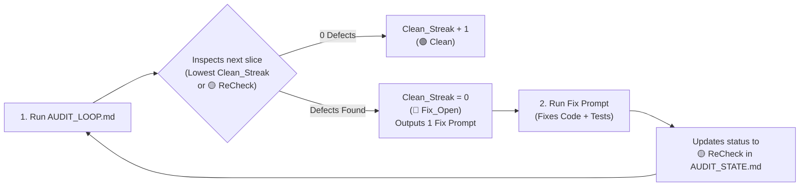

# 🤖 HuMoCo Universal AI Audit Loop

> **Credo:** *"In decentralization there is no trust, only mathematical proofs."*  
> **Doctrine:** *"Subtraction before Construction – One Single Audit Loop, Zero Blind Spots."*

This directory contains the streamlined, self-orchestrating AI verification system for `human-money-node`. The previous 25 fragmented prompts have been consolidated into **one single universal audit loop** powered by a persistent memory ledger.

---

## 🗂️ Structure

* **[`AUDIT_LOOP.md`](AUDIT_LOOP.md)**: **The ONE prompt.** Safe against cybersecurity/Daybreak false-positives, self-orchestrating, and produces either a clean streak confirmation or a ready-to-use fix prompt.
* **[`AUDIT_STATE.md`](AUDIT_STATE.md)**: **The memory ledger.** Divides 100% of workspace code into 9 deterministic slices (`S01`–`S09`) and tracks `Clean_Streak`, `Last_Run`, and `Status` (`🟢 Clean`, `🔴 Fix_Open`, `🟡 ReCheck`).
* **[`reports/`](reports/)**: Historical audit reports, regression test logs, and fix plan documentation.
* **[`archive/`](archive/)**: Preserved legacy audit suite (Prompts `00`–`25`, Stufen 1–6, and `AUDIT_REGISTRY.md`).

---

## 🚀 How to Run the Audit

### Option 1: In AI Chat (Antigravity, ChatGPT, Claude)
Simply reference or copy [`prompts/AUDIT_LOOP.md`](AUDIT_LOOP.md):
> *"Führe den Audit-Loop aus: @prompts/AUDIT_LOOP.md"*

The AI will:
1. Check [`prompts/AUDIT_STATE.md`](AUDIT_STATE.md) for any pending `🟡 ReCheck` or the slice with the lowest `Clean_Streak`.
2. Inspect the files in that slice against all architectural invariants and engineering safety rules.
3. Update [`prompts/AUDIT_STATE.md`](AUDIT_STATE.md).
4. If clean: output a 3-line confirmation. If bugs were found: output **exactly one copy-pasteable Fix Prompt** for your coding agent.

### Option 2: Automated via OpenCode or Model-Router
```bash
# Run the audit loop via OpenCode
opencode run --file prompts/AUDIT_LOOP.md

# Or via model-router
model-router run "$(cat prompts/AUDIT_LOOP.md)"
```

---

## 🔄 The Closed-Loop Lifecycle


